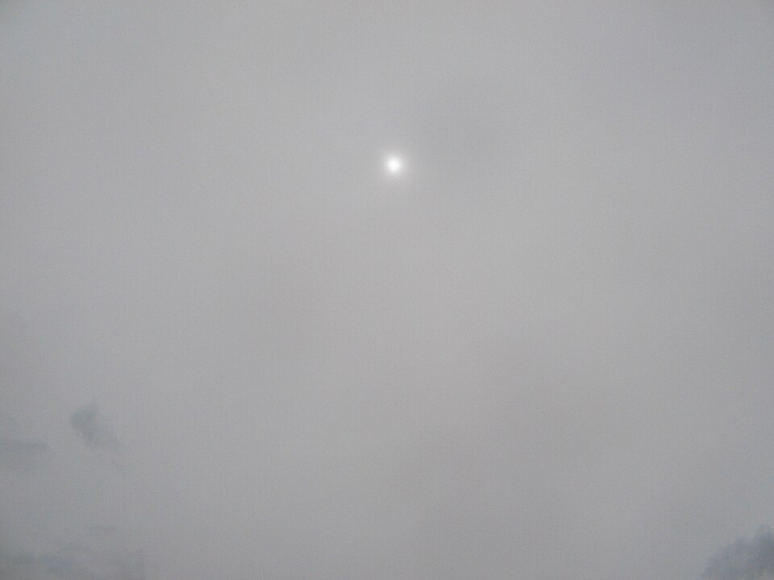
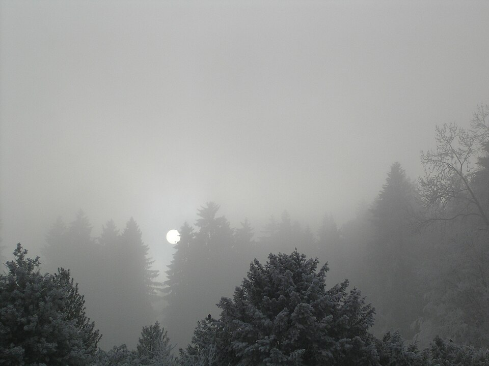

# Cloud atlas

Find a sky that looks like yours. Open a photograph to compare two more views and learn what change to watch for.

[Українська](../uk/README.md)

| | |
| --- | --- |
| [**Cirrus**](clouds/cirrus.md)  White streaks cross the blue sky. They taper to fine threads, sometimes with a hook at one end. | [**Cirrocumulus**](clouds/cirrocumulus.md)  Tiny white grains gather into rows like ripples on water. Even the centres of the grains look pale. |
| [**Cirrostratus**](clouds/cirrostratus.md)  A thin white veil covers the sky. A pale ring may circle the sun or moon. | [**Altocumulus**](clouds/altocumulus.md)  White and grey clumps sit in rows. Each often has a bright crest and a darker side. |
| [**Altostratus**](clouds/altostratus.md)  Grey cloud fills the sky. The sun looks like a glow behind frosted glass. | [**Nimbostratus**](clouds/nimbostratus.md)  Steady rain or snow falls from a grey sheet. The horizon fades from view. |
| [**Stratocumulus**](clouds/stratocumulus.md)  Broad rolls stretch across the sky. Look for pale ridges and darker hollows. | [**Stratus**](clouds/stratus.md)  The sky is smooth and grey. The sun may show through with a sharp rim. |
| [**Cumulus**](clouds/cumulus.md)  Separate white clouds have flat bases and rounded tops like cauliflower. | [**Cumulonimbus**](clouds/cumulonimbus.md)  One cloud towers over its neighbours. Its top may spread into a wide shelf. |
