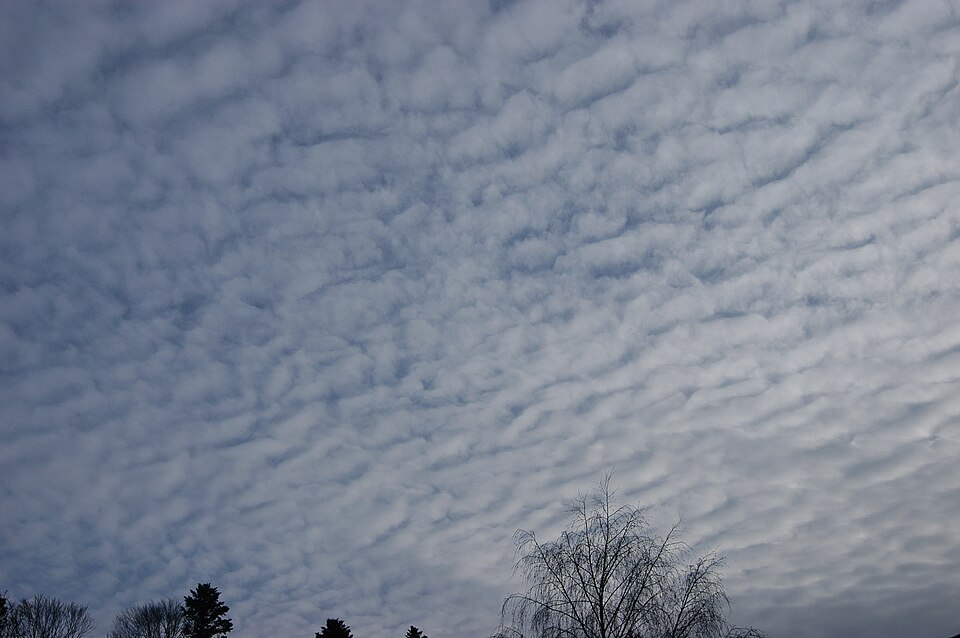
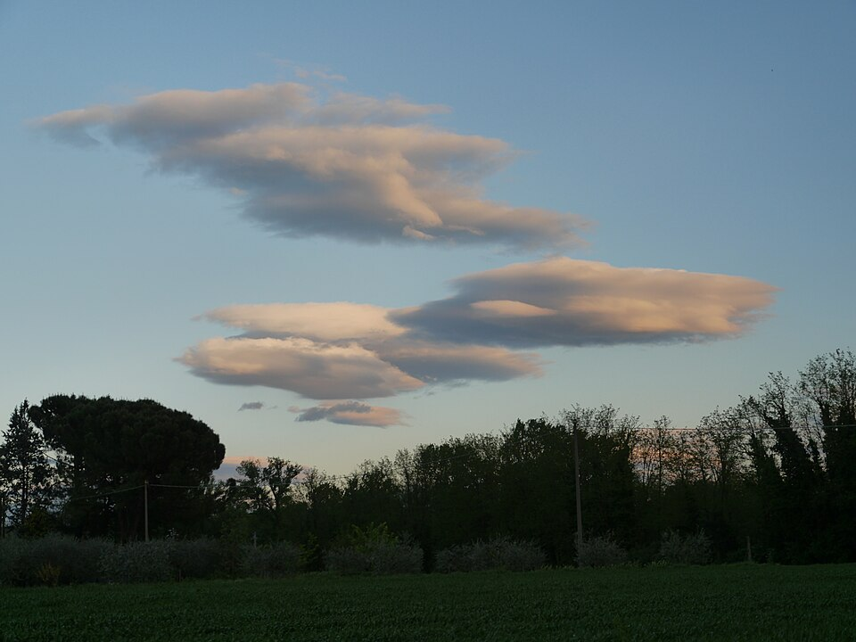

# Altocumulus

## What you can see from the ground

Look overhead for groups of white or grey clumps or rolls. One side of each clump often looks bright and the other grey. In a similar patch of [cirrocumulus](cirrocumulus.md), the white grains look smaller and show little or no shade.

## How the cloud is built

These clumps often lie side by side in a broad patch or sheet. In temperate regions they usually lie about 2–7 kilometres above the ground. They consist mostly of tiny water drops. Less light gets through the thicker parts, which gives the clumps their grey shading.

## How it forms

As moist air rises, it cools and some of its invisible water vapour becomes tiny drops. Nearby, sinking air warms and the drops evaporate, leaving a gap. When the air rises and falls in waves, clouds can form in rows along the crests. Downwind of hills, a smooth lens can stay in place as wind blows through it. Drops keep forming where the air rises and evaporating where it sinks.

## What it means for the weather

The ground often stays dry under flat rows of altocumulus. Look again in an hour or two. Widening gaps suggest the layer is breaking up, and longer spells of sunshine can warm the ground. If small turrets grow along a morning band, like teeth along the top of a wall, air is still rising there. That can be a clue that [thunderclouds](cumulonimbus.md) may develop later. Watch for a separate, much taller cloud that keeps growing. The small turrets alone give little indication of where a shower might fall.

## A name from Japan

In Japan these clouds are sometimes called *hitsujigumo* (ひつじ雲), or “sheep clouds.” Look for rounded white clumps gathered like a flock.

## Weather folklore

A Japanese small-boat navigation guide records a sign of fair weather: an unbroken overcast gives way to altocumulus. The change is the clue. If blue gaps keep widening, that supports the idea that the sky is clearing for now.

## Photographs

Towards the lower left, a strip of shade separates each bright crest from the next.

Above the trees the individual clumps merge into long, rippling bands.

The cloud on the right is smooth and tapers at both ends. This is the lens-shaped form of altocumulus.

## Reference

[WMO International Cloud Atlas · Altocumulus](https://cloudatlas.wmo.int/en/clouds-genera-altocumulus.html)

[Japan Meteorological Agency’s Meteorological Research Institute · Japanese cloud names](https://www.mri-jma.go.jp/Dep/typ/araki/sorawatch.html)

[Ibaraki Prefecture · “Sheep clouds” and the resemblance to a flock](https://www.edu.pref.ibaraki.jp/katei/images/page/11/takahagioutdoor.pdf)

[Japan Ministry of Land, Infrastructure, Transport and Tourism · Small-boat navigation guide, weather and clouds](https://www.mlit.go.jp/common/001374383.pdf#page=127)

[Photo credits and reuse terms](../../../docs/photo-selection/altocumulus/README.md)

[Українська](../../uk/clouds/altocumulus.md)
