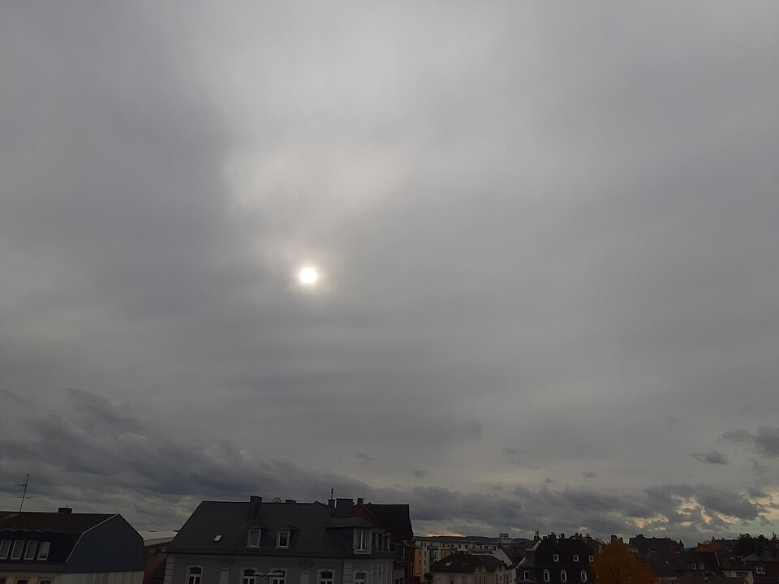
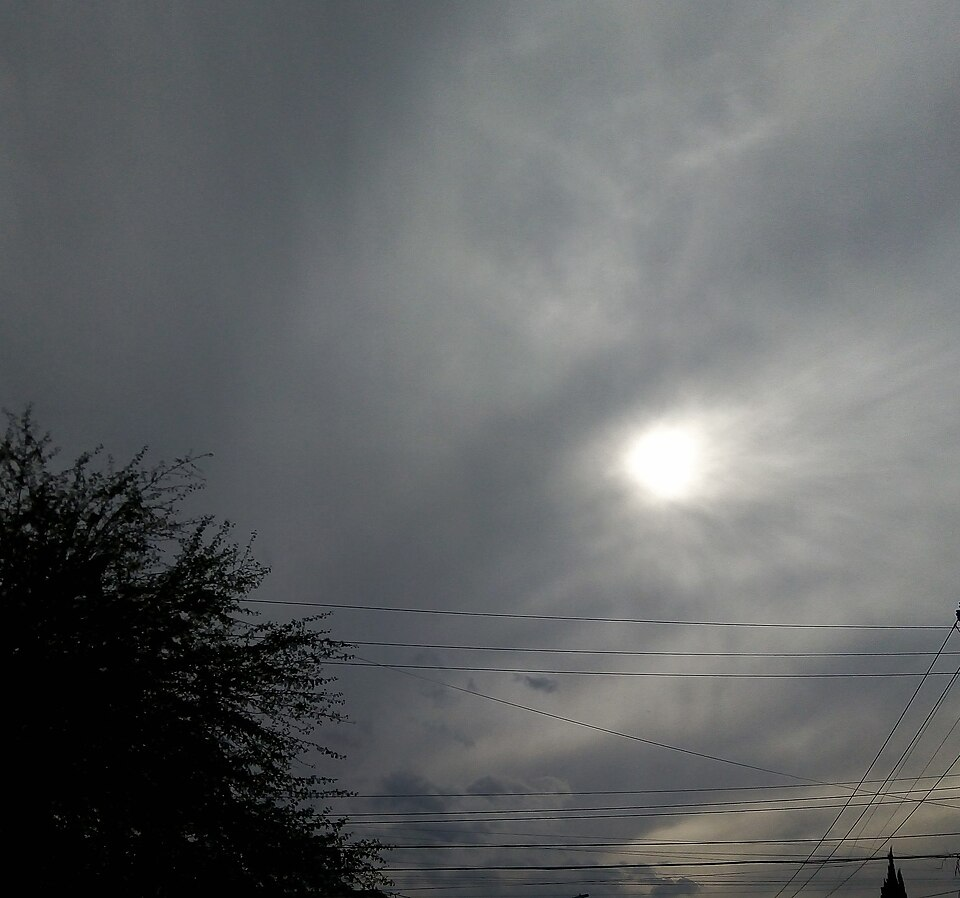

# Altostratus

## What happened to the shadows?

Objects on the ground still cast shadows through a thin [cirrostratus veil](cirrostratus.md). Under altostratus, sunlight is so scattered that shadows all but disappear. The sun itself may still show through. Long bands of slightly different greys sometimes show across the sheet.

## Why so much sky clouds over at once

Warm air can ride slowly up over colder air. It cools as it rises, and some of the water vapour you could not see turns into droplets and ice crystals. The resulting sheet of cloud can stretch for hundreds of kilometres. In temperate latitudes this cloud usually lies roughly 2–7 km above the ground and can extend higher.

## Will the rain reach the ground?

Sometimes grey streaks hang below the sheet and fade in mid-air. This is virga. Precipitation is already falling from the cloud, but the air below is dry enough for the drops to evaporate or the ice crystals to turn to vapour.

If the pale sun disappears over the next few hours and distant landmarks fade behind falling rain or snow, a longer spell of precipitation becomes more likely. Once it is falling steadily from a dark, continuous sheet, compare the sky with [nimbostratus](nimbostratus.md). The sequence can also reverse as the sun grows brighter and shadows return to the ground.

## Photographs

The sun is still visible. A faint glow around it fades gradually into the grey sheet.

The bands above the roofs differ in brightness, but there are no blue gaps between them.

On the right, sunlight comes through a thinner part of the cloud. The same sheet looks dark farther left.

[WMO International Cloud Atlas — Altostratus](https://cloudatlas.wmo.int/en/clouds-genera-altostratus.html) · [WMO — Cloud levels](https://cloudatlas.wmo.int/en/some-useful-concepts-levels.html)

[Photo credits and reuse terms](../../../docs/photo-selection/altostratus/README.md)

[Українська](../../uk/clouds/altostratus.md)
