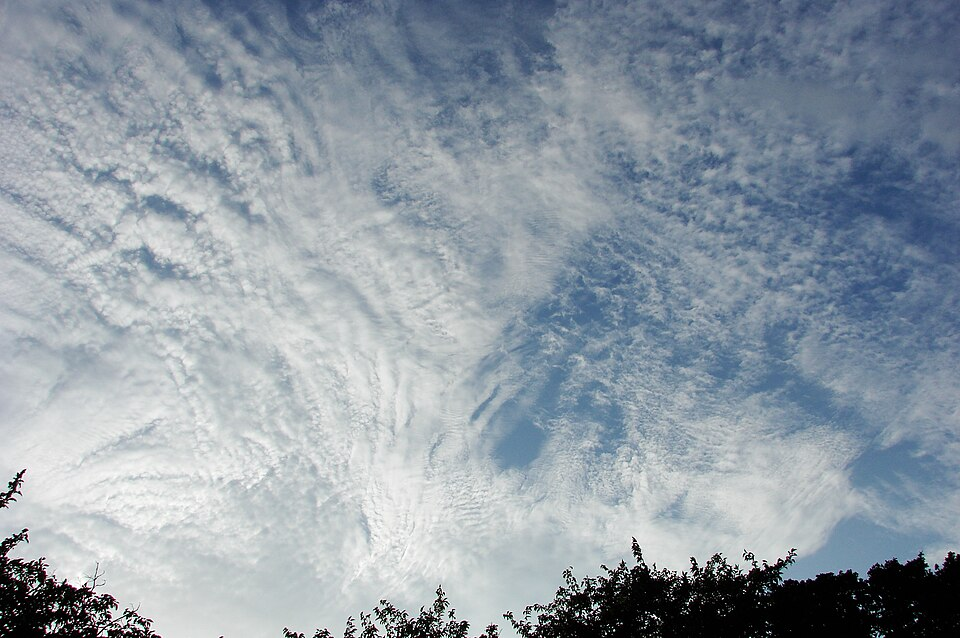
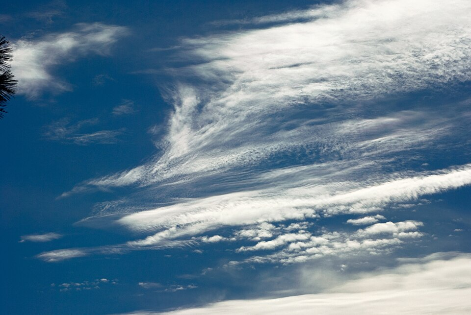

# Cirrocumulus

## What to look for

Cirrocumulus looks like a thin scattering of white grains. Find a patch well above the horizon and follow its texture across the sky. The grains may stand apart, merge into ripples or surround small blue holes. Individual grains usually have little or no visible shading. [Altocumulus](altocumulus.md) can form similar rows, with larger elements that often have shaded sides. Clouds near the horizon appear smaller, so compare elements higher in the sky.

## Where it forms and how it changes

In temperate regions, Cirrocumulus usually occupies the high cloud level, roughly 5–13 km above the ground. This range describes where the genus commonly occurs. The apparent size of the grains depends on both their actual size and their distance from you.

Cirrocumulus consists mainly of tiny ice crystals. Liquid droplets can briefly persist below freezing before ice crystals take over. When a moist layer rises and cools in a wave, cloud can form in the rising part and thin where the air sinks. Repeated waves can produce rows of ripples. Fine grains can also develop in an existing sheet of high cloud. As the surrounding air dries, the grains and rows may fade.

## What it can tell you about the weather

The pattern tells you about moisture and motion high above you. Occasionally, a faint tail falls from a patch and disappears in the air. Meteorologists call this virga. It may be easier to see against a dark patch of blue. Cirrocumulus alone offers little guidance about rain at ground level, surface wind or how warm the afternoon will be.

## Photographs

White grains spread across open blue sky and gather into narrow rows at right.

Fine white ripples curve upward from the dark treeline and break into specks around an opening.

Look above the bright diagonal streak. Small blue gaps interrupt the thin, grainy band.

## Reference

[WMO International Cloud Atlas · Cirrocumulus](https://cloudatlas.wmo.int/en/clouds-genera-cirrocumulus.html)

[Photo credits and reuse terms](../../../docs/photo-selection/cirrocumulus/README.md)

[Українська](../../uk/clouds/cirrocumulus.md)
