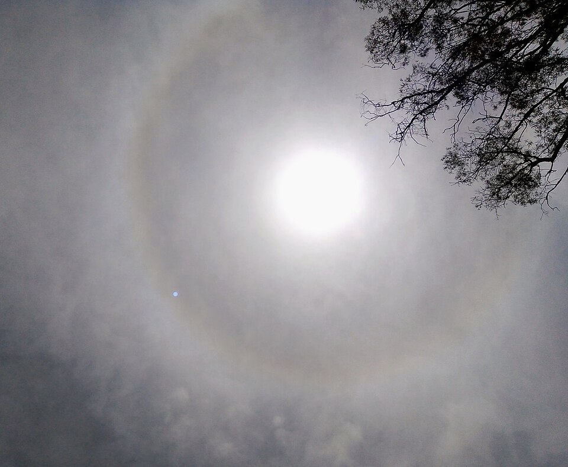

# Cirrostratus (Cs)

## What to look for

Look for a thin whitish veil across part or all of the sky. It may be smooth, like a pale wash over the blue, or threaded with faint fibers. The Sun or Moon usually remains visible through it. [Cirrus](cirrus.md) often has a similar fibrous texture, but its strands and patches are usually separated by clearer gaps. Use a building to shield the Sun’s disk when viewing its halo.

## Where it forms

In temperate latitudes, Cirrostratus typically occupies part of the high-cloud layer, roughly 5–13 km above the surface. It can form when a broad area of moist air rises and cools and ice crystals grow. A common clue is the 22° halo. Light bends as it passes through six-sided ice crystals, producing a ring about 22° from the Sun or Moon. Crystal shape and arrangement affect whether the ring is clear enough to see.

## What may happen next

The veil can linger for hours or thin out as the cloud drifts away or the air dries. When the veil spreads and gives way to thicker grey [Altostratus](altostratus.md), the Sun may become a dim blur. Continued thickening and lowering over the next several hours can precede widespread rain or snow, especially ahead of a front. A halo by itself gives little basis for timing or locating precipitation.

When the sky thickens, check whether the wind at your level also turns or strengthens and whether pressure falls across several readings. These observations together make an approaching weather system more plausible. Surface temperature can rise or fall depending on the air mass that arrives and how much sunshine reaches the ground.

## Photographs

Look from the Sun toward the corners. Blue shows through a continuous pale veil, with a faint ring near the Sun.

Between the dark rooftops, faint slanted fibers cross the veil. The low Sun shows through on the right.

Trace the broad ring around the Sun, especially the lower arc away from the branches.

[WMO International Cloud Atlas · Cirrostratus](https://cloudatlas.wmo.int/en/clouds-genera-cirrostratus.html)

[Photo credits and reuse terms](../../../docs/photo-selection/cirrostratus/README.md)

[Українська](../../uk/clouds/cirrostratus.md)
