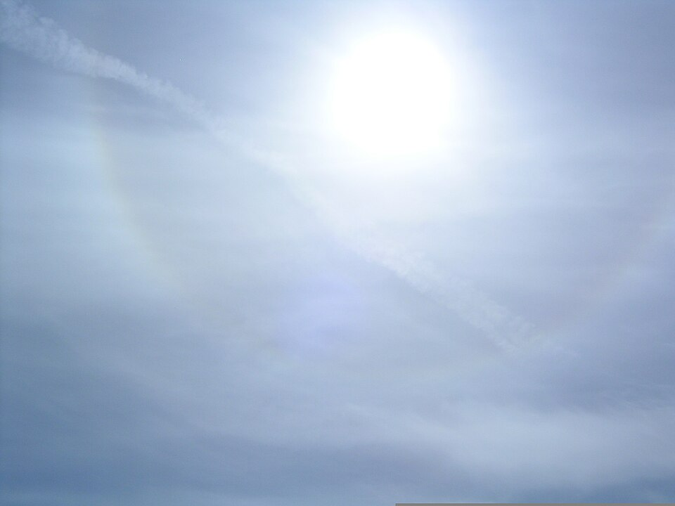
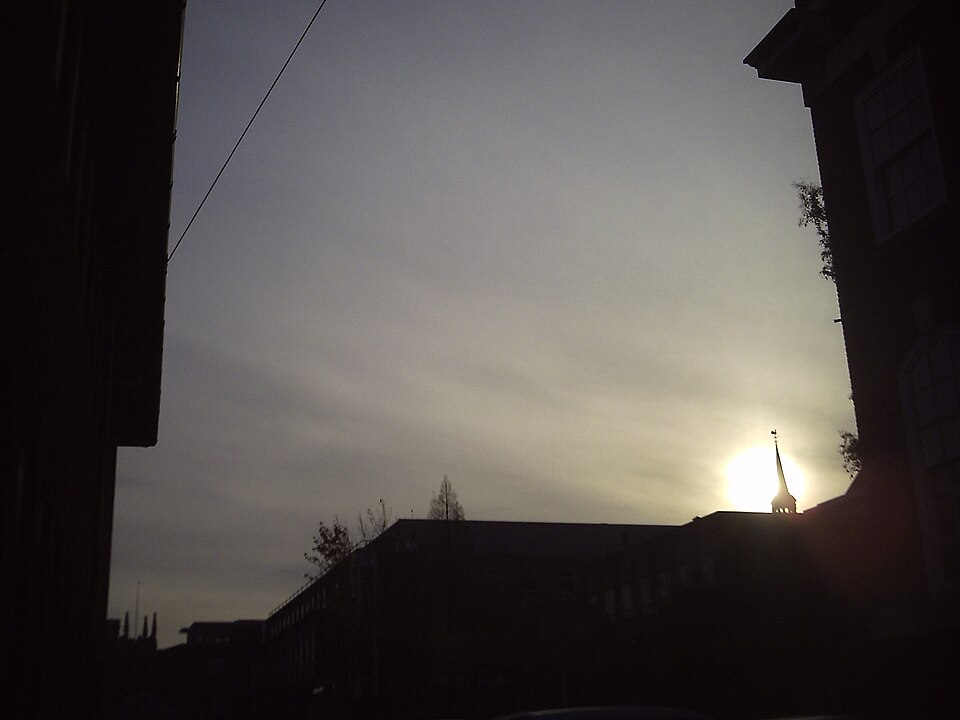

# Cirrostratus (Cs)

## The cloud that gives itself away with a ring

On some nights the moon shines clearly, yet a circle of light hangs far out around it. This is a halo. In temperate latitudes it often forms in a thin ice cloud 5–13 km up. Light bends as it passes through six-sided crystals. The common halo has a radius of about 22°, roughly the width of an outstretched hand at arm’s length. In daylight, block the sun itself with the edge of a roof while you look for the ring.

You can spot the veil even without a halo. The blue looks washed out over a wide area, yet a post or a tree still casts a sharp shadow. With separate [cirrus streaks](cirrus.md), patches of deeper, clearer blue show between the white threads.

## When the veil thickens

Think back to where the veil ended a few hours ago. If it now covers the whole sky, has turned grey, and shadows on the ground have faded, you may already be looking at [altostratus](altostratus.md). You can see this sequence when warmer air advances over colder air. The boundary is called a warm front. Steady rain or snow may follow. If the veil thins and the blue deepens again, there is less reason to expect that sequence to continue.

## Photographs

Blue still shows in the lower corners, but the thin cloud washes out the colour even there.

Faint slanting fibres cross the sky above the roofs. The pale veil continues between them.

The lower arc of the halo stands well clear of the bright glow next to the sun.

[WMO International Cloud Atlas · Cirrostratus](https://cloudatlas.wmo.int/en/clouds-genera-cirrostratus.html)

[Photo credits and reuse terms](../../../docs/photo-selection/cirrostratus/README.md)

[Українська](../../uk/clouds/cirrostratus.md)
