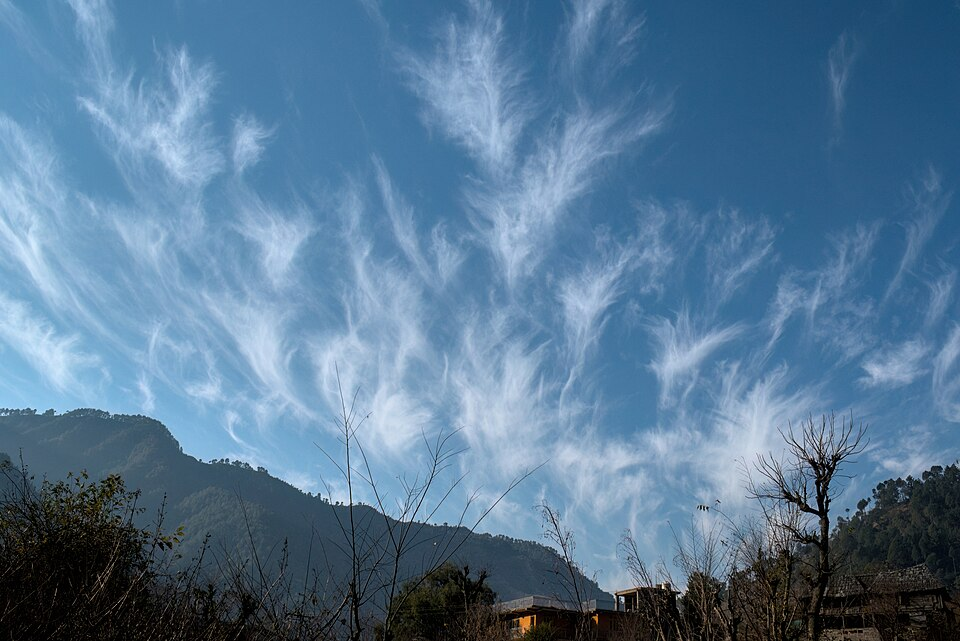
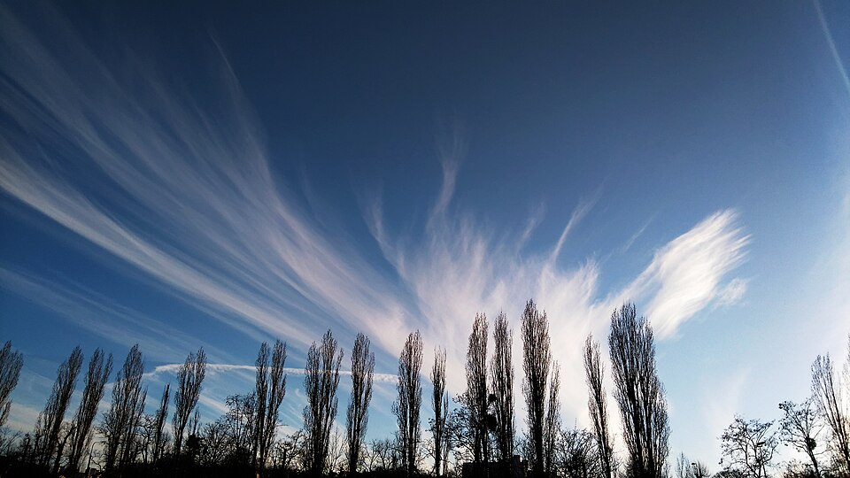

# Cirrus (Ci)

## What you can see from the ground

Thin white strands stand out against blue sky, like loose feathers. Some curl into hooks. Others spread into fans or run in nearly parallel lines. Look for separate strands with blue gaps between them.

## How the cloud is built

In temperate regions, these clouds typically lie about 5–13 km above the ground. Each strand contains countless tiny ice crystals. Together they scatter sunlight, which makes the strand look white.

## How it forms

When moist air rises and cools high in the atmosphere, water vapour can turn directly into ice crystals. Some crystals slowly fall into air where the wind moves at a different speed or in a different direction. This draws them out into a long, sometimes curved tail.

## What it means for the weather

A few wisps can pass on a dry day. Ice falling from them usually turns back into water vapour before reaching the ground. The streaks reflect winds high overhead, and it can be calm where you stand.

Look again in a few hours. If a [thin white veil](cirrostratus.md) spreads across the gaps and the sky later turns grey as thicker clouds arrive, the boundary between warmer and colder air may be approaching. This boundary is called a front. When warmer air rises over colder air, the highest clouds can appear first, followed by lower, thicker clouds that may bring steady rain or snow. Falling pressure at the same location adds another clue.

## Where the name comes from

The World Meteorological Organization traces *cirrus* to a Latin word for a lock of hair, a tuft of horsehair or a bird’s tuft. The name fits the thin strands that flare or curl at one end.

## Weather folklore

In Scotland, feathery streaks were called “goat’s hair” and taken as a sign of wind to come. The streaks show how the wind is carrying ice aloft. On the water, you can check whether the wind is picking up where you are. Is a patch of ripples spreading? Does your sail fill more often? High streaks can drift over smooth water too.

## Photographs

The long bands near the top bend the same way, with clear blue sky between them.

The wisps above the ridge curl into hooks, each with a fine tail.

On the left, a broad white streak separates into fine, nearly parallel threads.

[WMO International Cloud Atlas · Cirrus](https://cloudatlas.wmo.int/en/clouds-genera-cirrus.html)

[WMO International Cloud Atlas · Origin of the Latin names](https://cloudatlas.wmo.int/appendix-1-etymology-of-latin-names-of-clouds.html) · [Dictionaries of the Scots Language · Goat’s hair](https://dsl.ac.uk/entry/snd00071667)

[Photo credits and reuse terms](../../../docs/photo-selection/cirrus/README.md)

[Українська](../../uk/clouds/cirrus.md)
