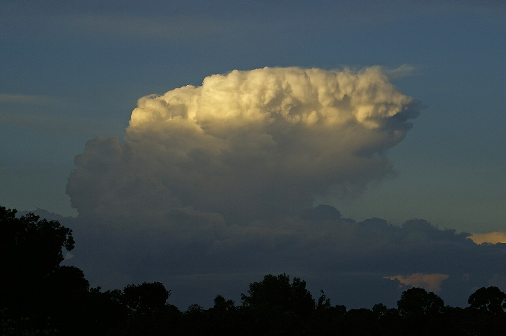
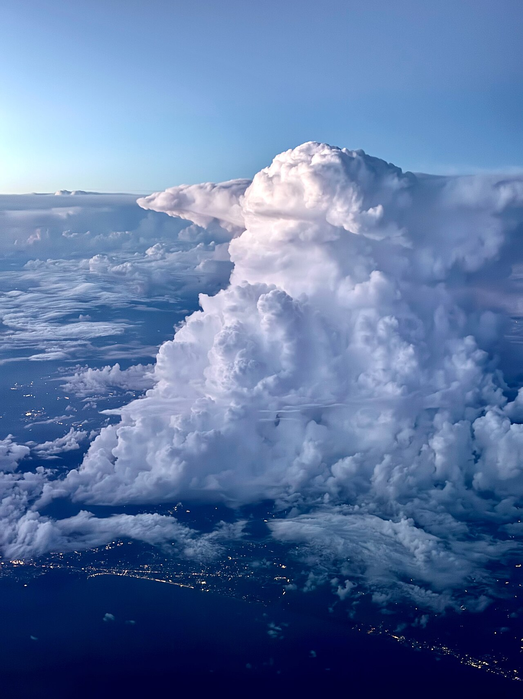

# Cumulonimbus

## Looking from the side or from underneath

From a distance, compare the cloud with a [cumulus](cumulus.md) beside it. On the smaller cloud you can pick out rounded white bulges. As the taller cloud grows, ice forms aloft and the part that was sharply rounded begins to look smooth or fibrous. Where the rising air slows down, cloud can spread sideways into a shape called an anvil. Sometimes you can see that shelf long before you can see the rain.

Standing directly underneath, you may see only dark sky. The cloud hides its own shape. In temperate latitudes the part nearest the ground often hangs less than 2 km up, while the cloud can grow to 5–13 km or higher. Thunder is a sign of a nearby storm even when its outline is hidden.

## Why wind can arrive before rain

From a distance, a heavy shower often looks like a dark curtain joining cloud and ground. Some drops evaporate as they fall, cooling the surrounding air. The cooler air descends and spreads when it reaches the surface. This can bring a sudden chill and gust of wind on a warm, still day. Over smooth water you may even see a line of ripples running ahead of the rain.

If the curtain hides first a distant landmark and then a nearer one in the same direction, the rain is moving towards you and may arrive within minutes. If it tracks along the horizon, the shower may pass to one side and the gust can still reach you. When you hear thunder, seek shelter even if it is still dry where you are.

## Photographs

Left of centre, a wide white shelf projects from the tall cloud. The smaller heaps on the right have sharper outlines.

Evening sunlight picks out the crown while much of the cloud is in shade. The low sun adds to the contrast here.

From the air you can see how far the tower rises above its neighbours. High on the tower, cloud extends to the left.

[WMO International Cloud Atlas — Cumulonimbus](https://cloudatlas.wmo.int/en/clouds-genera-cumulonimbus.html) · [Cloud levels](https://cloudatlas.wmo.int/en/useful-concepts.html) · [US National Weather Service — The sound of thunder](https://www.weather.gov/safety/lightning-science-thunder)

[Photo credits and reuse terms](../../../docs/photo-selection/cumulonimbus/README.md)

[Українська](../../uk/clouds/cumulonimbus.md)
