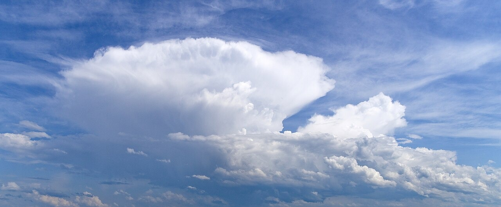

# Cumulonimbus

## What you can see from the ground

From a distance, look for a cloud that towers above its neighbours. A young tower has rounded white bulges. As a thundercloud develops, the edges may smooth out or fray into pale streaks. Beneath the cloud you may see only a broad, dark base, with no view of the top.

## How the cloud is built

The tower holds water droplets lower down and ice crystals high up. The top often flattens and spreads sideways into a broad shelf called an *anvil*. In temperate latitudes the part nearest the ground usually hangs less than 2 km up, while the tower can reach 5–13 km or higher.

## How it forms

When warm, moist air rises, it cools. Some of its invisible water vapour turns into droplets. A [cumulus cloud](cumulus.md) can grow into a tall tower if moist air continues to rise. Higher up, some drops freeze. Tiny ice crystals and heavier pieces of ice bump together and acquire different electrical charges. Moving air carries them to different parts of the cloud. When enough charge builds up, a flash of lightning can follow. Where the rising air slows near the top, it spreads sideways, carrying ice crystals with it and forming the anvil.

## What it means for the weather

A grey curtain reaching the ground shows where rain is already falling. If it moves toward you, a heavy shower may arrive within minutes. Some rain evaporates as it falls, cooling the air. That cooler air can sink and spread along the surface. You may feel a cool gust even if the rain passes to one side. Over the next hour or two, watch for the curtain to fade. The anvil can remain visible after the shower ends. If you hear thunder, seek shelter.

## A Japanese name for a summer cloud

In Japan, a towering summer cloud is often called *nyūdōgumo* (入道雲). One explanation likens its rounded white crown to a Buddhist monk’s shaven head. The name can also describe a tall cumulus whose rounded outline is still clear.

## Weather folklore

In the Scottish village of Rosehearty, folklorist Walter Gregor recorded a belief that afternoon thunder was followed by fine, warm weather. Thunder tells you that lightning has occurred nearby. For signs that the shower is passing, look for the rain curtain moving away and clear sky opening behind the cloud. The time of day alone gives little clue to what follows. [Walter Gregor — Weather Folk-Lore of the Sea](https://en.wikisource.org/wiki/Folk-Lore/Volume_2/Weather_Folk-Lore_of_the_Sea)

## Photographs

Left of centre, a wide white shelf projects from the tall cloud. The smaller heaps on the right have sharper outlines.

Evening sunlight picks out the crown while much of the cloud is in shade. The low sun adds to the contrast here.

From the air you can see how far the tower rises above its neighbours. High on the tower, cloud extends to the left.

[WMO International Cloud Atlas — Cumulonimbus](https://cloudatlas.wmo.int/en/clouds-genera-cumulonimbus.html) · [Cloud levels](https://cloudatlas.wmo.int/en/useful-concepts.html) · [US National Weather Service — The sound of thunder](https://www.weather.gov/safety/lightning-science-thunder) · [US National Weather Service — Thunderstorm Life Cycle](https://www.weather.gov/spotterguide/life) · [Japan Meteorological Agency — Summer showers](https://www.jma.go.jp/jma/kids/kids/faq/a1_04.html)

[Gakken · A Japanese name for a summer cloud](https://kids.gakken.co.jp/jiten/dictionary05200316/)

[Photo credits and reuse terms](../../../docs/photo-selection/cumulonimbus/README.md)

[Українська](../../uk/clouds/cumulonimbus.md)
