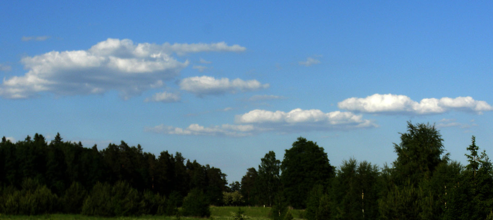

# Cumulus

## What gives the cloud its shape?

A white cloud drifts across a field. Seen from the side, its edge facing the ground is almost straight. On the side facing blue sky, it bulges into rounded white heaps. When the same cloud passes directly overhead, all you may see is a grey patch.

Sunshine warms the ground. The ground warms the air touching it, which rises and cools. There is water in the air in the form of invisible vapour. At a certain height the rising air becomes cool enough for some of that water to form tiny drops. Together the drops are visible. This is where the straight edge of the cloud begins, often less than 2 km up in temperate regions. Higher up, separate pockets of air keep rising. Each adds another white bulge to the cloud.

## Could it turn into a shower?

A small cloud gives you a few minutes of shade. Its drops are so small that they often evaporate, leaving the ground dry. Look at the same cloud a few minutes later. If fresh bulges keep rising from one spot until the cloud towers above its neighbours, air is still rising through the cloud. Inside it, drops bump into one another and join. Once enough drops have grown large, they can fall as a shower. If it grows taller still and begins to spread into white streamers high up, compare it with [cumulonimbus](cumulonimbus.md).

## Photographs

The white outline rises in rounded steps. The shaded edge facing the ground is almost straight.

On the right, the flat edges of several clouds line up above the trees.

Against the blue sky on the right, the tallest cloud still has sharply outlined white bulges.

[WMO International Cloud Atlas](https://cloudatlas.wmo.int/en/clouds-genera-cumulus.html)

[Photo credits and reuse terms](../../../docs/photo-selection/cumulus/README.md)

[Українська](../../uk/clouds/cumulus.md)
