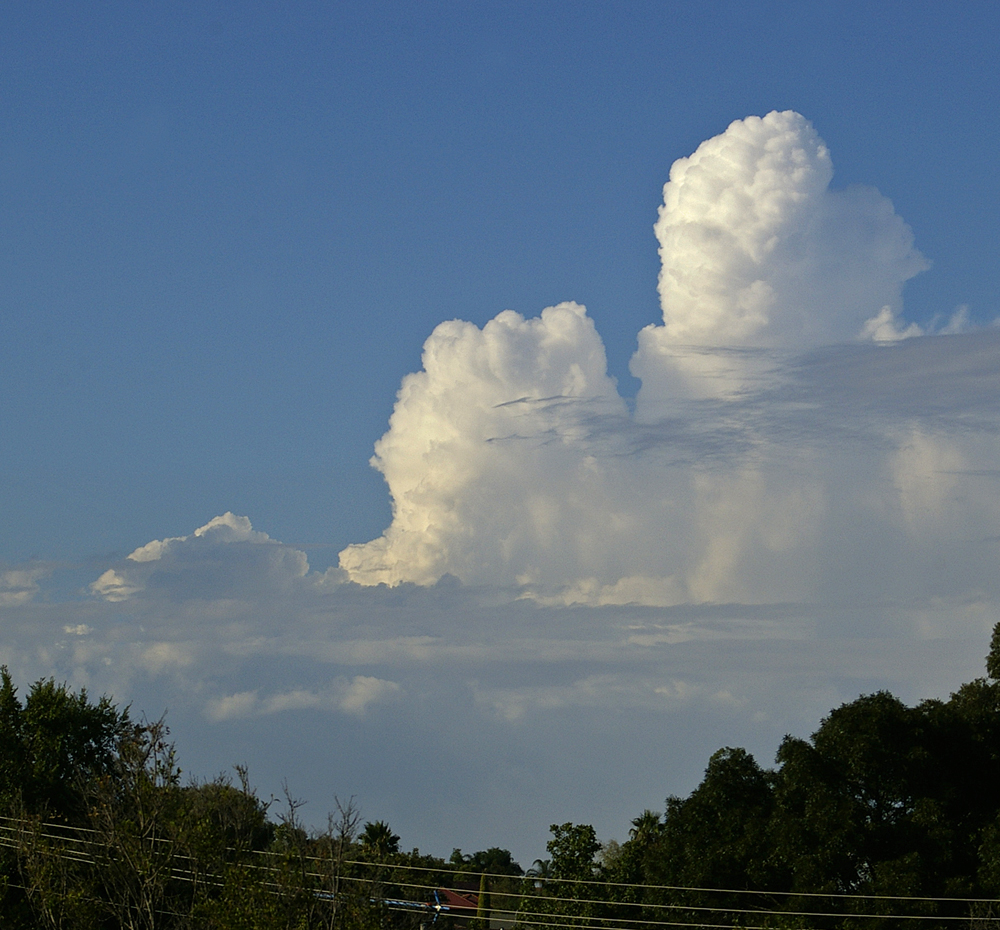

# Cumulus

## What you can see from the ground

Separate white clouds drift across the sky. Rounded bulges stand out against the blue like cauliflower florets. The edge facing the ground often looks almost straight. It is easy to see from the side. When the cloud passes overhead, you may see only a grey patch.

## How the cloud is built

Each white heap consists of countless tiny water drops. The bulges catching the sun look white. Less light gets through the thickest part, so the side facing the ground often looks grey even on a fine day. The nearly level edge marks the height where visible drops begin — the cloud’s *base*. In temperate regions this is often less than two kilometres up. Above it the cloud may be quite shallow or grow into a tall tower.

## How it forms

Sunshine warms a field and the field warms the air touching it. The air rises, expands and cools. It contains water in the form of invisible vapour. At a certain height it becomes cool enough for some of the vapour to turn into drops. That is where the cloud begins. If air over neighbouring fields is equally warm and moist, drops begin forming at much the same height. This is why the bases of several clouds can line up.

Higher up, one pocket of warm air rises after another. Where a pocket reaches the edge of the cloud and drops form in it, a fresh white dome bulges out. Similar clouds form at sea when cool air passes over warmer water.

## What it means for the weather

If the clouds stay shallow with plenty of blue between them, it usually stays dry underneath. When one passes in front of the sun, the shade can feel cool for a moment. As soon as the cloud moves on, you feel the sun again.

Remember the outline of a cloud some distance away and look again in a few minutes. If the bulges fray and blue shows through, the drops there are evaporating. If new domes keep rising above the same base, the cloud is growing. A tall cumulus tower can already give a shower. When its sharp, rounded outline gives way to fuzzy white streamers, compare it with [cumulonimbus](cumulonimbus.md).

## What a painter wrote on the back of his cloud study

On 11 September 1821 the English painter John Constable painted small cumulus clouds at Hampstead. The study shows sunlight catching their rounded tops. On the back, Constable later noted that it rained the following night. One side records what the sky looked like, the other what the weather did later.

## Weather folklore

An English collection of weather observations, *The Shepherd of Banbury’s Rules*, records a saying about clouds that look like rocks and towers. It takes them as a sign of showers. The image captures how cumulus looks when it has grown tall. To see where rain is already falling, look from the white tower down to the horizon beneath it. A grey curtain may have appeared there, hiding part of the landscape.

## Photographs

The white outline rises in rounded steps. The shaded edge facing the ground is almost straight.

On the right, the flat edges of several clouds line up above the trees.

Against the blue sky on the right, the tallest cloud still has sharply outlined white bulges.

[WMO International Cloud Atlas](https://cloudatlas.wmo.int/en/clouds-genera-cumulus.html)

[Met Office · Low-level clouds](https://weather.metoffice.gov.uk/learn-about/weather/types-of-weather/clouds/low-level-clouds)

[National Gallery of Australia · John Constable’s cloud study, 11 September 1821](https://digital.nga.gov.au/archive/exhibition/constable/detail.cfm%3Firn%3D143229%26bioartistirn%3D18283%26mnuid%3D2%26galid%3D7.html)

[The Shepherd of Banbury’s Rules](https://www.gutenberg.org/cache/epub/24163/pg24163-images.html)

[Photo credits and reuse terms](../../../docs/photo-selection/cumulus/README.md)

[Українська](../../uk/clouds/cumulus.md)
