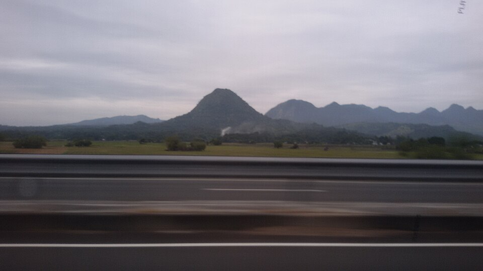
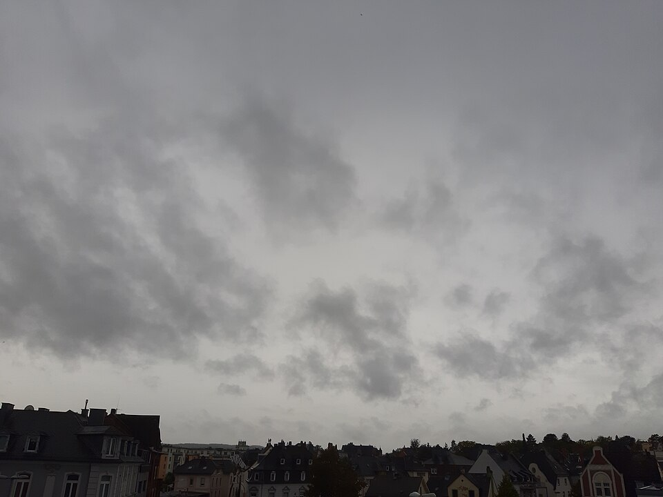

# Nimbostratus

## What you can see from the ground

The sky is grey from edge to edge. Even in daylight it is hard to tell where the sun is. Rain falls steadily, gradually blurring the outline of a distant shore or wood. Dark, ragged scraps sometimes drift across the lighter grey overhead.

## How the cloud is built

This is a broad, thick sheet of cloud. In temperate regions much of it lies 2–7 kilometres up, and the part nearest the ground often extends below 2 kilometres. The sheet contains water drops and, higher up where it is colder, ice crystals and snowflakes. It is thick enough to hide the sun completely.

From the ground it is hard to tell where the cloud begins. Drops or snowflakes are already falling between you and the cloud, blurring its edge. The dark scraps that stand out against it are separate little clouds. They form closer to the ground, where some raindrops evaporate and add moisture to the air.

## How it forms

It often starts with [altostratus](altostratus.md), through which the sun still shows as a pale spot. Warmer air rises slowly over colder air and cools as it goes. Water that was invisible vapour forms drops and ice crystals. The sheet grows both upwards and downwards until the pale spot of sunlight disappears.

High inside the cloud, crystals grow and stick together into snowflakes. The flakes may fall several kilometres. If they pass through a deep enough stretch of warm air on the way down, they melt. The rain you hear outside your window may have started its journey as snow.

## What it means for the weather

Rain or snow can fall from this cloud for hours. While some drops have already reached the ground, new ones are forming overhead. The sheet stretches a long way, and the wind can bring the next rain-bearing part of it over you.

During a lull, look towards the horizon in the direction the clouds are coming from. If the view is still grey and distant landmarks remain hidden, the lull may be brief. If the shore comes back into view through the rain and a bright strip widens above it, the edge of the wet weather may be drawing closer.

## What a rain cloud shares with a painted halo

Both take their name from the Latin *nimbus*. One meaning of the word is “rain cloud”, which survives in *nimbostratus*. In art, a *nimbus* is the glow around a saint’s head. The second part of the cloud’s name, *stratus*, means “spread out”. Put the two together and you have a description of the view outdoors: a rain cloud spread across the sky.

## Weather folklore

In a nineteenth-century British guide for mariners, Admiral Robert FitzRoy recorded the saying “Long foretold — long last, short notice — soon past.” It described changes of weather in general. Under nimbostratus it is easy to recognise the observation behind it. In the morning, sunshine still came through a thin veil. The sky turned grey in the afternoon, and the first drops fell towards evening. A wide band of rain can approach gradually in just this way. How long it rains where you are also depends on how quickly the band passes.

## Photographs

One shade of grey blends into the next. Without observing the precipitation, this view alone is hard to identify.

The ridge has a sharp outline, but the lower edge of the cloud above it is hard to place.

The scraps above the roofs hang below the main layer. The same grey sheet shows through the gaps between them.

[WMO International Cloud Atlas — Nimbostratus](https://cloudatlas.wmo.int/en/clouds-genera-nimbostratus.html) · [WMO — Nimbostratus and thick Altostratus](https://cloudatlas.wmo.int/en/ns-compared-with-as-op.html)

[WMO · Clouds beneath the rain sheet](https://cloudatlas.wmo.int/en/explanatory-remarks-nimbostratus.html)

[Met Office · Mid-level clouds](https://weather.metoffice.gov.uk/learn-about/weather/types-of-weather/clouds/mid-level-clouds)

[The origins of nimbus](https://www.dictionary.com/browse/nimbus)

[Robert FitzRoy · Barometer and Weather Guide](https://www.gutenberg.org/ebooks/23921)

[Photo credits and reuse terms](../../../docs/photo-selection/nimbostratus/README.md)

[Українська](../../uk/clouds/nimbostratus.md)
