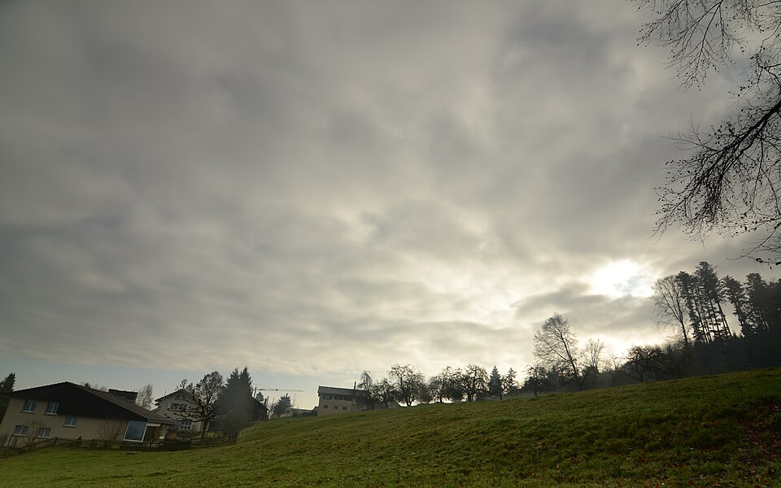
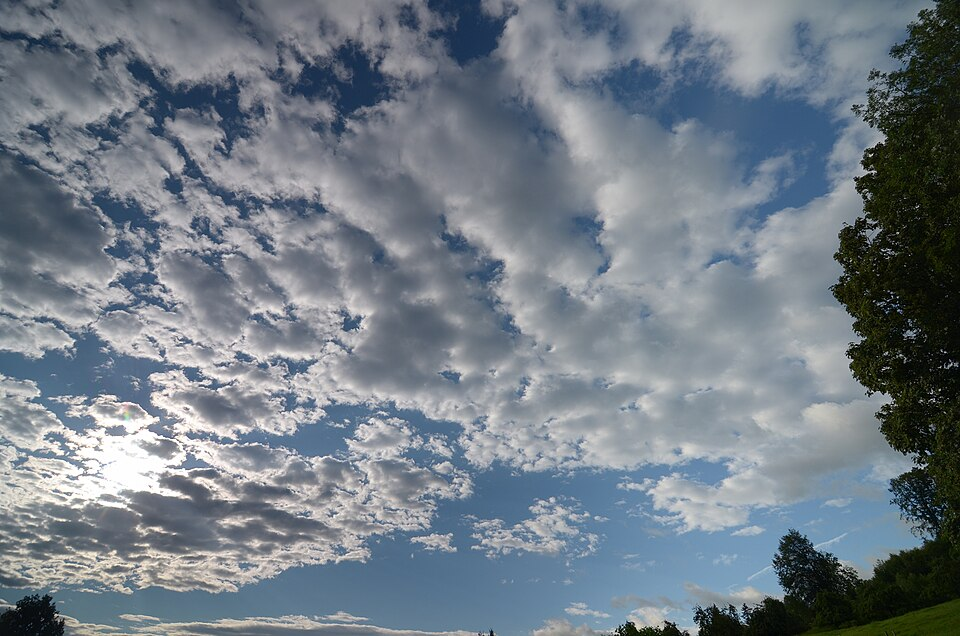

# Stratocumulus (Sc)

## One cloud or several?

Looking up, you can often follow a roll until it meets the next one or ends at a strip of blue. When the gaps close, the darker hollows still show where the rolls meet. A sheet of [stratus](stratus.md) at a similar height looks much smoother.

## How the rolls join up

In temperate latitudes you are usually looking at cloud less than 2 km above you. A morning of scattered [cumulus](cumulus.md) over a plain can turn into an almost unbroken afternoon sky. Rising air cools until some of its water vapour turns into visible droplets. If the rising air meets a layer of warmer air above, it may stop rising. The clouds spread sideways and join.

## Will the sun come out?

It often stays dry under these clouds, though thicker patches can give light rain or snow. If the gaps are getting wider as the surrounding cloud dissolves, you may see more sunshine over the next hour. A gap that keeps its shape as it passes overhead gives only a brief spell of sun.

Over land, a blanket of cloud can slow the warming of the ground by day. At night the ground loses heat quickly under clear skies. Under low cloud it usually cools more slowly if the wind stays much the same.

## Photographs

The low sun catches the edges of the rolls. Their rounded shape stands out on the right.

Above the bright patch on the horizon the rolls have almost merged. Pockets of shade still pick out individual shapes.

Near the middle of the picture, blue gaps separate the broad, rounded clumps.

[WMO International Cloud Atlas — Stratocumulus](https://cloudatlas.wmo.int/en/clouds-genera-stratocumulus.html)

[Photo credits and reuse terms](../../../docs/photo-selection/stratocumulus/README.md)

[Українська](../../uk/clouds/stratocumulus.md)
