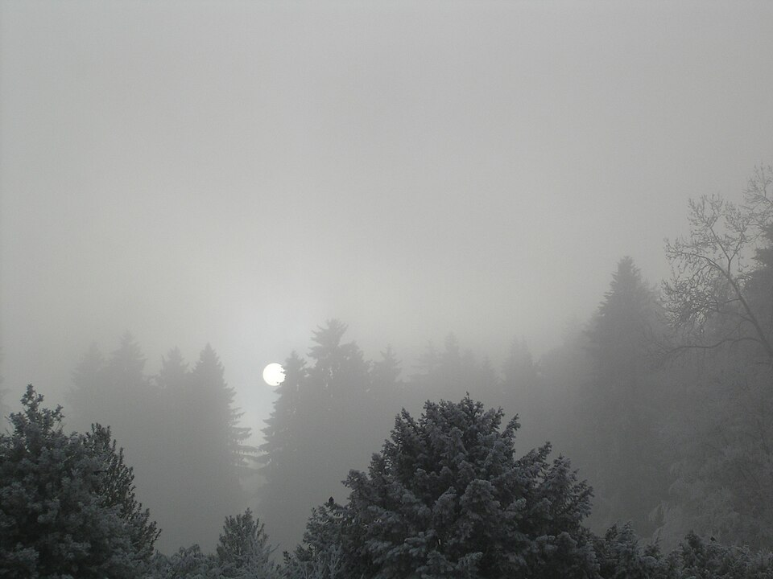
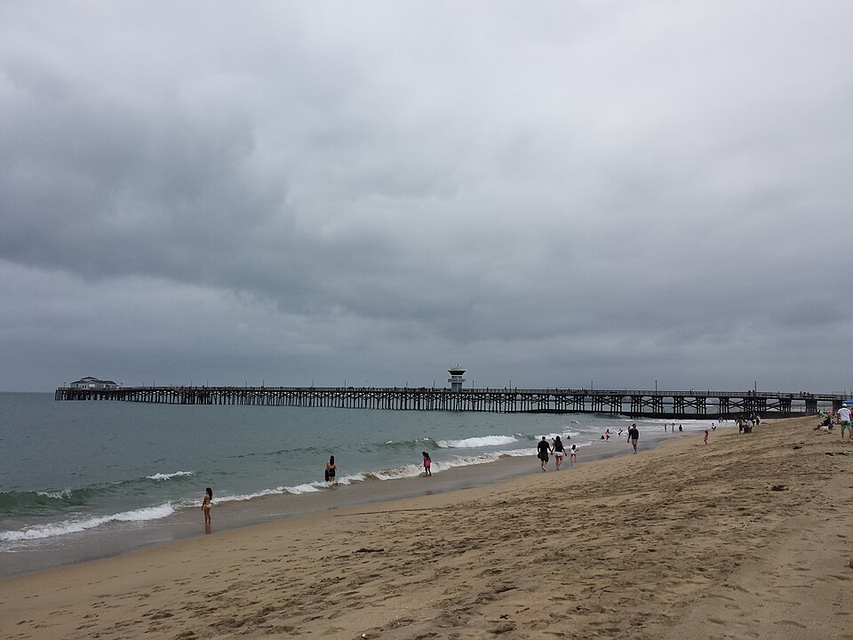

# Stratus (St)

## What you can see from the ground

Early in the morning you can barely make out the trees across a field. Later their trunks come back into view while their crowns are still lost in grey. You can see where the low cloud begins. Once it is above the trees, it may look like a smooth grey sky. If the layer is thin enough for the Sun to show, its disk has a clear edge.

## How the cloud is built

Stratus forms a broad, shallow sheet of tiny water drops. In temperate regions its underside can be just above the ground or as high as about 2 km. When the layer reaches the ground and hides distant objects, you are looking through fog.

## How it forms

Air contains invisible water vapour. On a clear night, the ground loses heat and cools the air touching it. Moist air can also cool as it moves across cold water. When the air cools enough, some of the vapour becomes tiny drops. If a shallow layer cools across a whole field or bay, the drops spread out in a sheet.

## What it means for the weather

Often it stays dry beneath this cloud. If drops join and grow, they can fall as drizzle, so fine that you may notice it first on a dark sleeve. Steady rain that hides a distant shore for hours is more typical of [nimbostratus](nimbostratus.md).

If sunshine warms the ground, drops at the bottom of the layer may evaporate first. Check whether more of the trees come into view, then look for blue gaps overhead. Over cold water the sheet can persist into the afternoon, especially while moist air keeps arriving.

## What people call it on Scotland’s east coast

People on Scotland’s east coast call a cold sea fog *haar*. In 1807, John Grierson wrote that the fog he described around St Andrews tended to clear as it reached warmer land inland. The same bank of drops can be fog at sea level and a low grey sheet where its underside clears the ground. [Dictionaries of the Scots Language](https://dsl.ac.uk/entry/snd00072388) · [Met Office](https://weather.metoffice.gov.uk/learn-about/weather/types-of-weather/fog)

## Weather folklore

An Irish Schools’ Collection notebook from County Louth records the saying “A mist in the morning is the sailors warning.” The warning fits what sailors can see. If a distant pier or headland fades and nearer boats start to disappear too, visibility is getting worse. The mist on its own gives little indication of whether rain will follow. [Irish National Folklore Collection](https://www.duchas.ie/en/cbes/5008837/4959852/5073291?transcribe=true)

## Photographs

The sun still has a sharp rim. Beyond the front row of trees, only faint outlines of the crowns show through.

Only the brightness changes across this patch of sky. There are no distinct rolls or separate clumps.

The low cloud stretches out to sea. The pier itself is still clearly visible underneath.

[WMO International Cloud Atlas — Stratus](https://cloudatlas.wmo.int/en/clouds-genera-stratus.html)

[Photo credits and reuse terms](../../../docs/photo-selection/stratus/README.md)

[Українська](../../uk/clouds/stratus.md)
