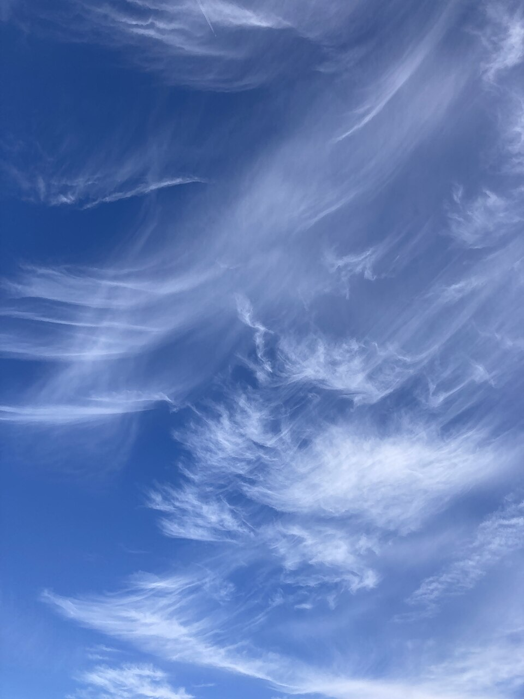

# Атлас хмар

Знайдіть небо, схоже на ваше. Відкрийте фото, щоб порівняти ще два знімки й дізнатися, за якою зміною варто стежити.

[English](../en/README.md)

| | |
| --- | --- |
| [**Перисті**](clouds/cirrus.md)  Тонкі волокна й гачки | [**Перисто-купчасті**](clouds/cirrocumulus.md)  Ряди дрібних білих зернят |
| [**Перисто-шаруваті**](clouds/cirrostratus.md)  Світла прозора пелена | [**Висококупчасті**](clouds/altocumulus.md)  Округлі елементи із затіненням |
| [**Високошаруваті**](clouds/altostratus.md)  Сіра завіса з тьмяним Сонцем | [**Шарувато-дощові**](clouds/nimbostratus.md)  Суцільний дощовий покрив |
| [**Шарувато-купчасті**](clouds/stratocumulus.md)  Низькі округлі вали | [**Шаруваті**](clouds/stratus.md)  Низький однорідний сірий шар |
| [**Купчасті**](clouds/cumulus.md)  Окремі хмари з опуклими верхівками | [**Купчасто-дощові**](clouds/cumulonimbus.md)  Висока башта з волокнистою верхівкою |
