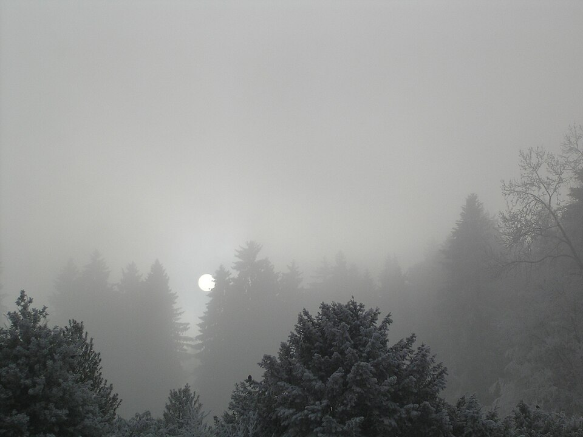

# Атлас хмар

Знайдіть небо, схоже на ваше. Відкрийте фото, щоб порівняти ще два знімки й дізнатися, за якою зміною варто стежити.

[English](../en/README.md)

| | |
| --- | --- |
| [**Перисті**](clouds/cirrus.md)  По синьому небу тягнуться білі пасма. Кінці в них тонкі, іноді загнуті гачком. | [**Перисто-купчасті**](clouds/cirrocumulus.md)  Ряди дрібних білих цяток схожі на брижі на воді. Навіть їхня середина світла. |
| [**Перисто-шаруваті**](clouds/cirrostratus.md)  Крізь білу пелену видно блакить. Довкола Сонця чи Місяця іноді сяє кільце. | [**Висококупчасті**](clouds/altocumulus.md)  Білі й сірі грудочки лежать рядами. У кожної часто видно світлий гребінь і темніший бік. |
| [**Високошаруваті**](clouds/altostratus.md)  Небо сіре від краю до краю. Сонце за хмарою схоже на світлу пляму за матовим склом. | [**Шарувато-дощові**](clouds/nimbostratus.md)  Із суцільної сірої хмари рівно йде дощ або сніг. За ним зникає обрій. |
| [**Шарувато-купчасті**](clouds/stratocumulus.md)  Широкі хмарні вали тягнуться поруч, наче хвилі. Між ними темніють заглибини. | [**Шаруваті**](clouds/stratus.md)  Небо рівномірно сіре. Подекуди крізь нього видно чіткий край Сонця. |
| [**Купчасті**](clouds/cumulus.md)  Окремі білі хмари з рівним низом. Зверху вони схожі на цвітну капусту. | [**Купчасто-дощові**](clouds/cumulonimbus.md)  Хмара височіє над сусідніми. З її верхівки іноді виступає біла «полиця». |
