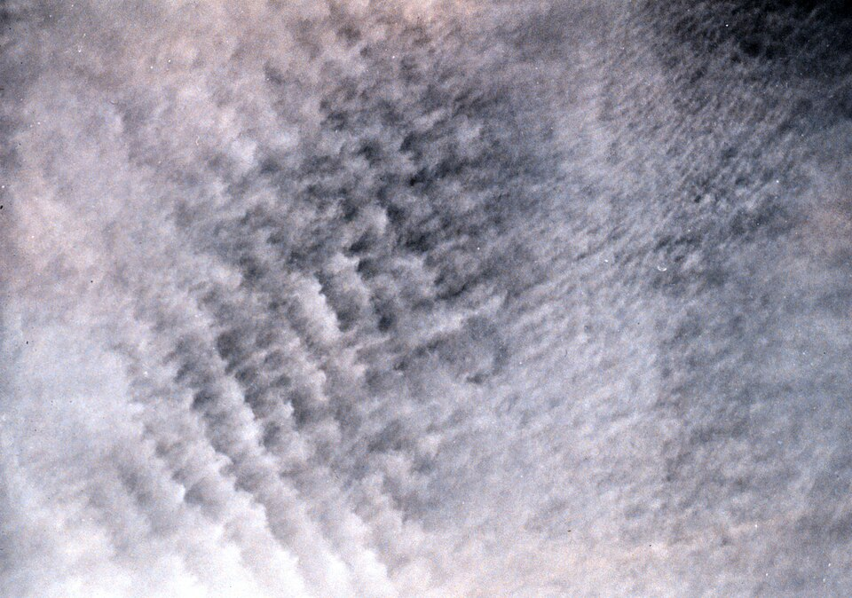
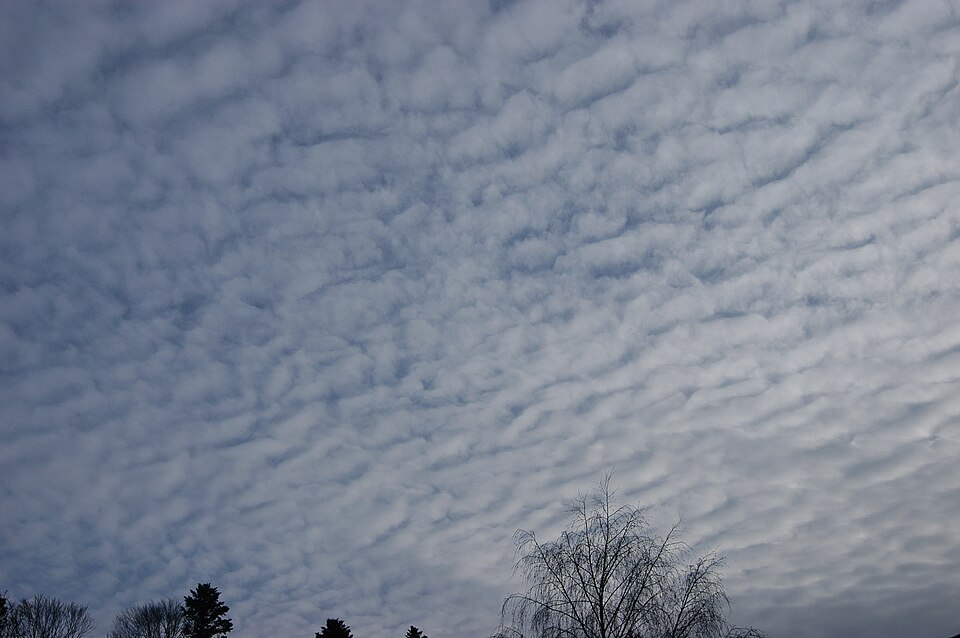
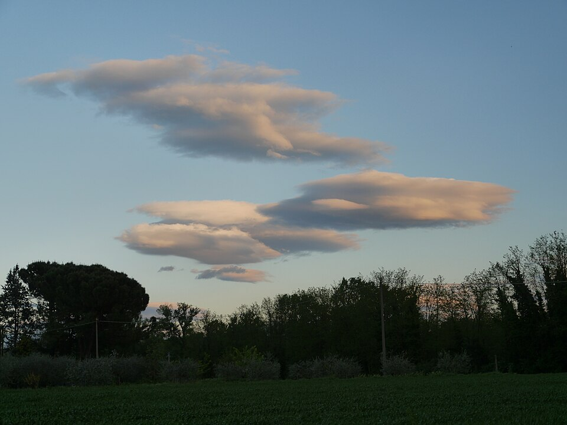

# Висококупчасті хмари (Altocumulus)

## Як розпізнати

Висококупчасті хмари утворюють ділянки або шари з округлих елементів. Придивіться, чи видно в одній ділянці і білі, і сірі частини. Одні елементи лежать окремо, інші зливаються у вали або смуги з вузькими просвітами. [Перисто-купчасті хмари](cirrocumulus.md) теж утворюють ряди, але їхні зернятка дрібніші й здебільшого без видимої тіні. Порівнюйте ділянки високо над горизонтом, де відстань і перспектива менше спотворюють видимий розмір елементів. Іноді висококупчасті хмари мають вигляд кількох гладких відокремлених лінз.

## Де утворюються і як змінюються

У помірних широтах висококупчасті хмари найчастіше трапляються в середньому ярусі, приблизно на висоті 2–7 км над землею. Частина цього діапазону збігається з висотами верхнього ярусу, тому під час спостереження із землі варто звертати увагу на форму й затінення елементів.

Висококупчасті хмари зазвичай складаються з дрібних крапель води, які можуть залишатися рідкими за температури нижче нуля. У холодніших частинах хмари іноді утворюються кристали льоду. Коли вологе повітря піднімається й охолоджується, водяна пара конденсується. На одному рівні можуть з’явитися кілька ділянок хмар і з’єднатися в ширший шар. Хвилі в потоці повітря здатні впорядкувати елементи в ряди. Над пагорбами чи горами така хвиля може утримувати лінзоподібну хмару на одному місці, хоча повітря весь час проходить крізь неї.

## Що підказують про погоду

Така хмара вказує на вологе повітря в середньому ярусі. У тонкій частині хмари дрібні краплі можуть утворити вінець, тобто кілька тісних кілець навколо Місяця. Кристали льоду іноді залишають сліди опадів, які зникають, не досягнувши землі. За однією ділянкою висококупчастих хмар важко визначити, коли почнеться дощ, якої сили буде приземний вітер і чи потеплішає біля землі.

## Фотографії

Від нижнього лівого краю до середини тягнуться світлі вали. Затінений бік підкреслює їхній об’єм.

Округлі хмари над деревами зливаються в майже паралельні сіро-білі смуги.

Широка лінза праворуч має гладкий верхній край, звужений кінчик і затінену нижню частину.

## Джерело

[Міжнародний атлас хмар ВМО · Altocumulus](https://cloudatlas.wmo.int/en/clouds-genera-altocumulus.html)

[Авторство фотографій та умови використання](../../../docs/photo-selection/altocumulus/README.md)

[English](../../en/clouds/altocumulus.md)
