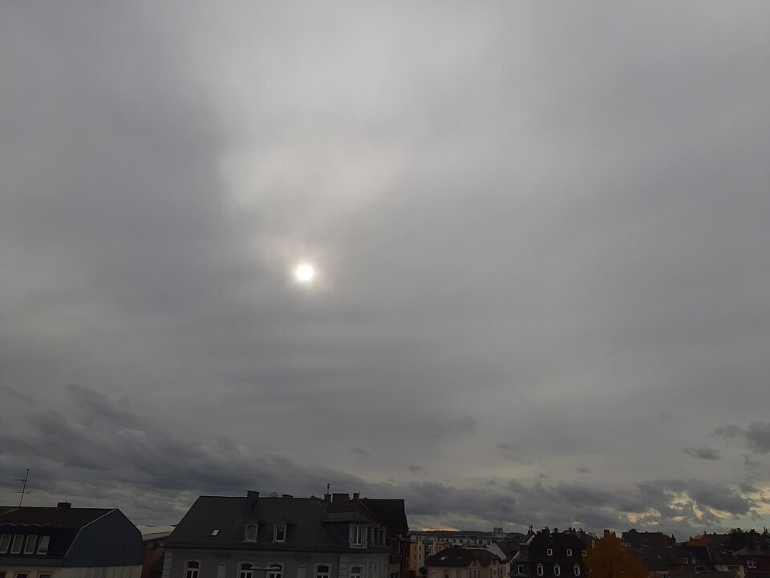
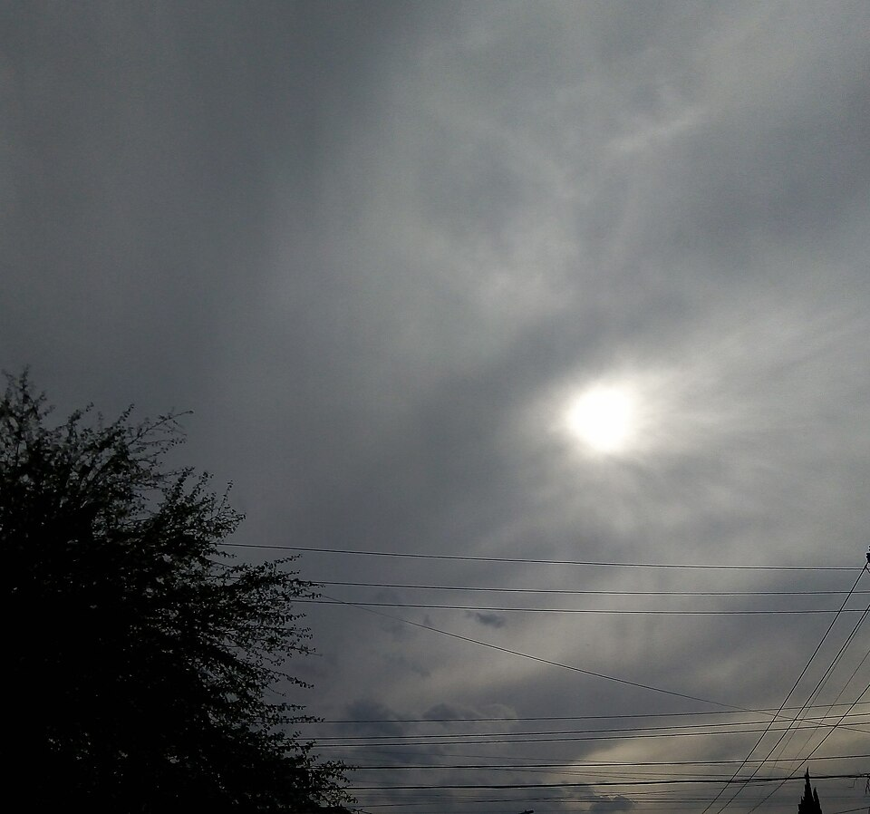

# Високошаруваті хмари (Altostratus)

## Наче сонце за матовим склом

Удень небо стає сірим, а сонце проступає як бліда пляма. Подивіться під ноги. Тінь, яка ще недавно мала чіткий край, ледве помітна. Хмара простягається далеко в усі боки. Світло багато разів змінює напрямок, проходячи крізь її краплі води й кристали льоду. Тепер землю освітлює велика ділянка неба, і тіні розмиваються.

## Чому хмара росте цілим шаром

Так буває, коли тепліше повітря поволі насувається на холодніше й підіймається над ним. На підйомі повітря остигає, і частина невидимої водяної пари в ньому стає краплями або льодом. Це може відбуватися над багатьма містами водночас. У помірних широтах така хмара зазвичай займає висоти близько 2–7 км, іноді сягаючи вище.

## Чи дійде дощ до землі

Іноді з хмари донизу тягнуться сірі смуги й обриваються на тлі світлого неба. У цих місцях дощ або сніг уже падає, але дорогою вода повертається в повітря у вигляді невидимої пари. Під ногами може бути сухо.

Якщо через кілька годин сонце зовсім зникає і за сірими смугами починають губитися далекі будинки, дощ або сніг може невдовзі дійти до вас. Поступове потовщення шару часто передує [тривалим опадам](nimbostratus.md). Якщо ж сонце світлішає і тіні повертаються, хмара тоншає.

## Фотографії

Сонце ще видно. Його оточує тьмяне сяйво, яке поступово зливається із сірим небом.

Смуги над дахами відрізняються за яскравістю, проте між ними ніде не відкривається синє небо.

Праворуч світло пробивається крізь тоншу частину хмари. Лівіше той самий шар виглядає темним.

[Міжнародний атлас хмар ВМО — Altostratus](https://cloudatlas.wmo.int/en/clouds-genera-altostratus.html) · [ВМО — яруси хмар](https://cloudatlas.wmo.int/en/some-useful-concepts-levels.html)

[Авторство фотографій та умови використання](../../../docs/photo-selection/altostratus/README.md)

[English](../../en/clouds/altostratus.md)
