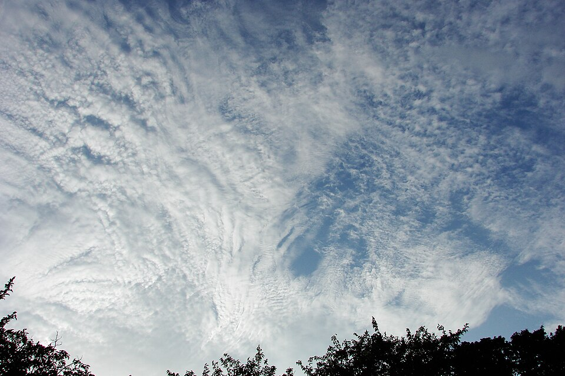
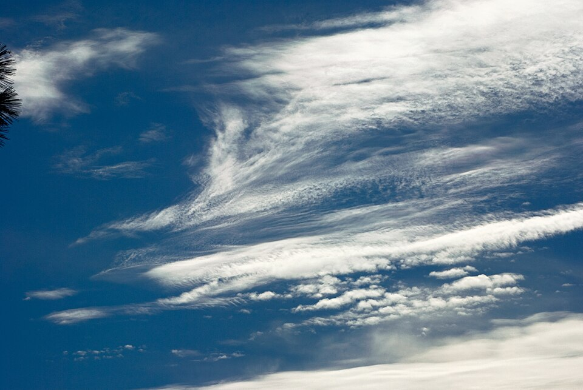

# Перисто-купчасті хмари (Cirrocumulus)

## Як розпізнати

Перисто-купчасті хмари схожі на розсип дрібних білих зерняток. Виберіть ділянку високо над горизонтом і простежте, як змінюється її візерунок. Зернятка можуть лежати окремо, зливатися у хвилясті ряди або облямовувати маленькі блакитні просвіти. На окремих елементах тіней зазвичай майже не видно. [Висококупчасті хмари](altocumulus.md) теж утворюють ряди, але їхні елементи виглядають більшими й часто мають затінений бік. Поблизу горизонту хмари здаються дрібнішими, тому порівнюйте ділянки вище в небі.

## Де утворюються і як змінюються

У помірних широтах перисто-купчасті хмари найчастіше трапляються у верхньому ярусі, приблизно на висоті 5–13 км над землею. Це типовий діапазон висот для цього роду хмар. Видимий розмір зерняток залежить і від їхнього справжнього розміру, і від відстані до спостерігача.

Ці хмари складаються переважно з дрібних кристалів льоду. Іноді в них ненадовго зберігаються рідкі краплі за температури нижче нуля. Коли вологе повітря піднімається у висхідній частині хвилі, воно охолоджується й може утворити хмару. Там, де повітря опускається, хмара тоншає. Кілька подібних хвиль можуть утворити паралельні ряди. Дрібні зернятка також часом з’являються у вже наявному шарі високих хмар і поступово зникають, якщо повітря стає сухішим.

## Що підказують про погоду

Візерунок свідчить про вологу й рух повітря високо над вами. Іноді під хмарою видно тонкий слід опадів, який зникає в повітрі. Таке явище називають віргою. Ледь помітний слід легше роздивитися на тлі темно-блакитного неба. За самими перисто-купчастими хмарами важко сказати, чи буде дощ біля землі, яким буде приземний вітер і наскільки потеплішає вдень.

## Фотографії

Білі зернятка розсипані по блакитному небу, а праворуч збираються у вузькі ряди.

Над темними верхівками дерев білі хвилясті ряди вигинаються і розпадаються на цятки довкола просвіту.

Над яскравою діагональною смугою видно тонку зернисту ділянку з малими блакитними просвітами.

## Джерело

[Міжнародний атлас хмар ВМО · Cirrocumulus](https://cloudatlas.wmo.int/en/clouds-genera-cirrocumulus.html)

[Авторство фотографій та умови використання](../../../docs/photo-selection/cirrocumulus/README.md)

[English](../../en/clouds/cirrocumulus.md)
