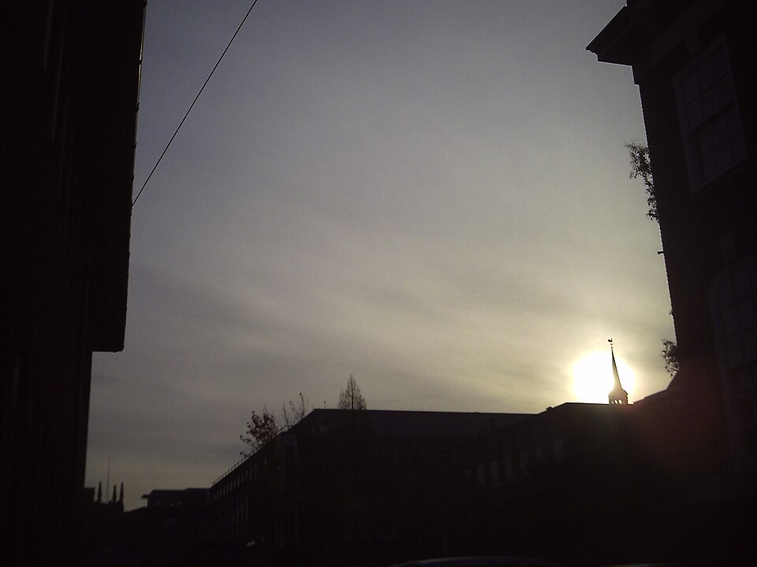
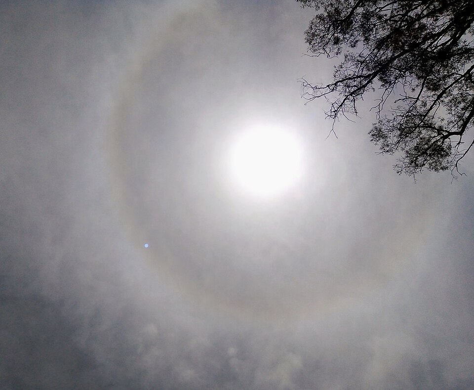

# Перисто-шаруваті хмари (Cirrostratus, Cs)

## Як упізнати

Шукайте тонку білувату пелену, яка вкриває частину неба або все небо. Вона може бути рівною, наче легкий білий серпанок, або з ледь помітними волокнами. Крізь неї зазвичай видно Сонце чи Місяць. [Перисті хмари](cirrus.md) теж бувають волокнистими, але між окремими пасмами частіше видно чисту блакить. Якщо помітили кільце навколо Сонця, затуліть сонячний диск будівлею чи іншим непрозорим предметом і роздивіться кільце.

## Де і як утворюються

У помірних широтах перисто-шаруваті хмари зазвичай займають частину верхнього ярусу, приблизно від 5 до 13 км над поверхнею. Вони можуть утворитися, коли волога повітряна маса на великій площі підіймається й охолоджується, а в ній ростуть кристалики льоду. Поширена ознака — гало радіусом 22°. Сонячне або місячне світло заломлюється в шестигранних кристаликах, і тоді навколо світила видно кільце. Його виразність залежить від форми кристаликів та їхнього розташування.

## Що може змінитися

Пелена може протриматися кілька годин або потоншати, коли хмара відходить чи повітря стає сухішим. Якщо пелена поширюється, а згодом її змінюють щільніші сірі [високошаруваті хмари](altostratus.md), Сонце може стати схожим на тьмяну пляму. Подальше ущільнення й опускання хмарного шару впродовж кількох годин іноді передує тривалому дощу чи снігу на великій площі, особливо перед фронтом. За самим гало важко визначити, де й коли почнуться опади.

Коли хмари ущільнюються, стежте, чи повертає або посилюється вітер біля поверхні та чи падає тиск у кількох вимірюваннях поспіль. Разом ці ознаки можуть вказувати на наближення фронту. Температура біля поверхні може зрости або знизитися залежно від того, яка повітряна маса надійде і скільки сонячного світла дістанеться поверхні.

## Фотографії

Переведіть погляд від Сонця до кутів кадру. Крізь суцільну бліду пелену проступає блакить, а біля Сонця видно слабке кільце.

Між темними дахами помітні тонкі косі волокна. Праворуч крізь пелену просвічує низьке Сонце.

Простежте широке кільце довкола Сонця. Найзручніше роздивитися його нижню дугу, де немає гілок.

[Міжнародний атлас хмар ВМО · Cirrostratus](https://cloudatlas.wmo.int/en/clouds-genera-cirrostratus.html)

[Авторство фотографій та умови використання](../../../docs/photo-selection/cirrostratus/README.md)

[English](../../en/clouds/cirrostratus.md)
