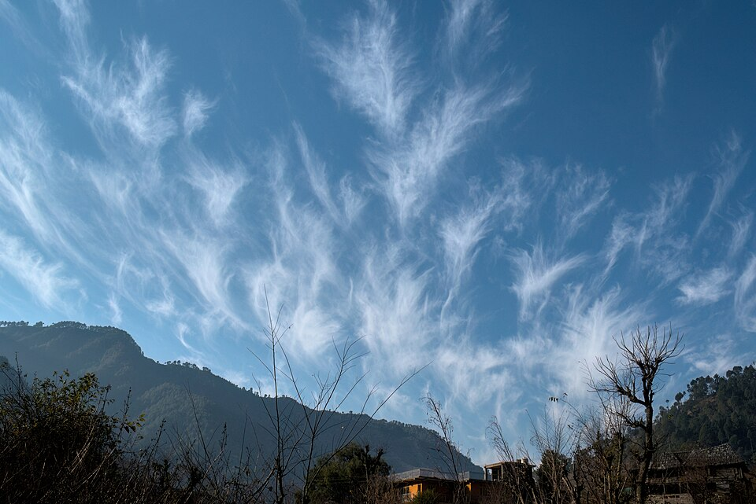
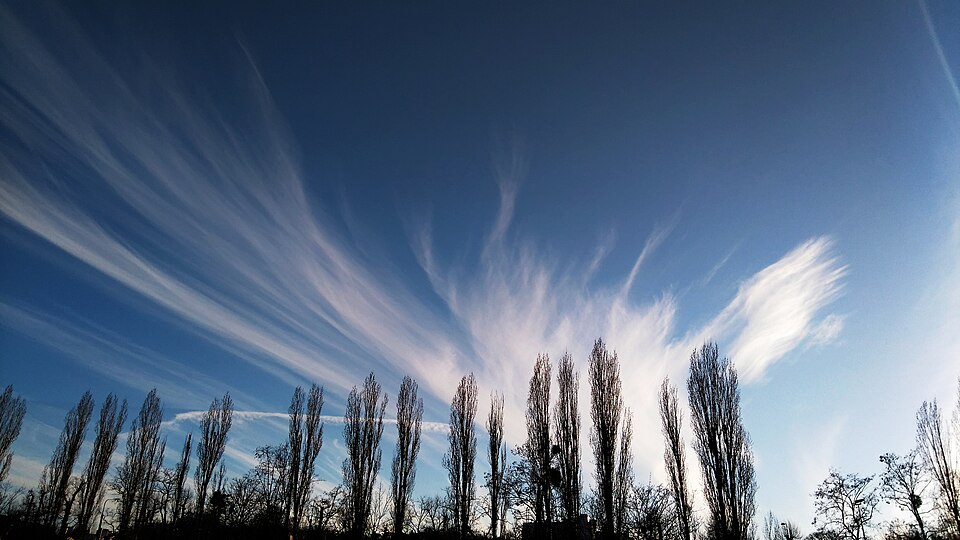

# Перисті хмари (Cirrus, Ci)

## Що видно із землі

На блакитному небі виділяються тонкі білі пасма, схожі на пір’я. Одні загинаються гачками, інші розходяться віялом або тягнуться майже паралельно. Між окремими пасмами видно блакитні просвіти.

## Як влаштована хмара

У помірних широтах ці хмари зазвичай лежать на висоті 5–13 км над землею. Кожне пасмо складається з безлічі дрібних кристалів льоду. Разом вони розсіюють сонячне світло, тому пасмо здається білим.

## Як вона утворюється

Коли вологе повітря високо в атмосфері підіймається й охолоджується, водяна пара може одразу перетворитися на кристали льоду. Частина кристалів повільно падає нижче, де вітер дме з іншою швидкістю або в іншому напрямку. Вітер відносить лід убік, і від пасма тягнеться довгий, іноді загнутий хвіст.

## Що вона означає для погоди

Кілька пасом можуть з’явитися й у сухий день. Лід, що падає з них, зазвичай перетворюється на водяну пару ще в повітрі. За формою пасом можна помітити рух повітря високо в небі. Біля землі тим часом може бути тихо.

Подивіться на небо ще раз за кілька годин. Якщо просвіти затягує [тонка біла пелена](cirrostratus.md), а за нею приходять щільніші сірі хмари, може наближатися межа між теплішим і холоднішим повітрям — фронт. Коли тепліше повітря підіймається над холоднішим, спочатку здалеку видно найвищі хмари. Нижчі й щільніші можуть прийти пізніше й принести тривалий дощ або сніг. Якщо тиск у тому самому місці падає, це ще одна підказка.

## Звідки походить назва

Всесвітня метеорологічна організація виводить назву *cirrus* з латинського слова, що означає пасмо волосся, жмут кінського волосся або пташиний чубчик. Таку назву легко пригадати, коли видно, як кінці білих пасом розходяться або загинаються.

## Народна прикмета

У Шотландії про тонкі розтріпані пасма казали «козяча шерсть» і вважали їх провісниками вітру. Пасма справді показують, як вітер розносить лід угорі. На воді перевірте, чи посилюється вітер і біля вас: чи ширшає смуга брижів, чи дедалі частіше натягується вітрило. Високі пасма можуть пропливти й над гладкою водою.

## Фотографії

Угорі довгі білі смуги загинаються в один бік. Між ними добре видно синє небо.

Над хребтом кінці пасом скручуються гачками, від кожного тягнеться тонкий хвіст.

Ліворуч широка біла смуга розходиться на довгі, майже паралельні нитки.

[Міжнародний атлас хмар ВМО · Cirrus](https://cloudatlas.wmo.int/en/clouds-genera-cirrus.html)

[Міжнародний атлас хмар ВМО · Походження латинських назв](https://cloudatlas.wmo.int/appendix-1-etymology-of-latin-names-of-clouds.html) · [Словники шотландської мови · Goat’s hair](https://dsl.ac.uk/entry/snd00071667)

[Авторство фотографій та умови використання](../../../docs/photo-selection/cirrus/README.md)

[English](../../en/clouds/cirrus.md)
