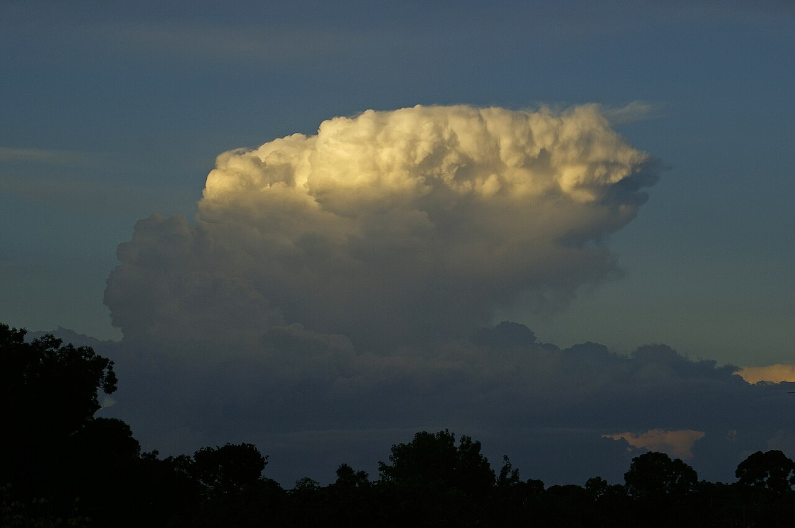
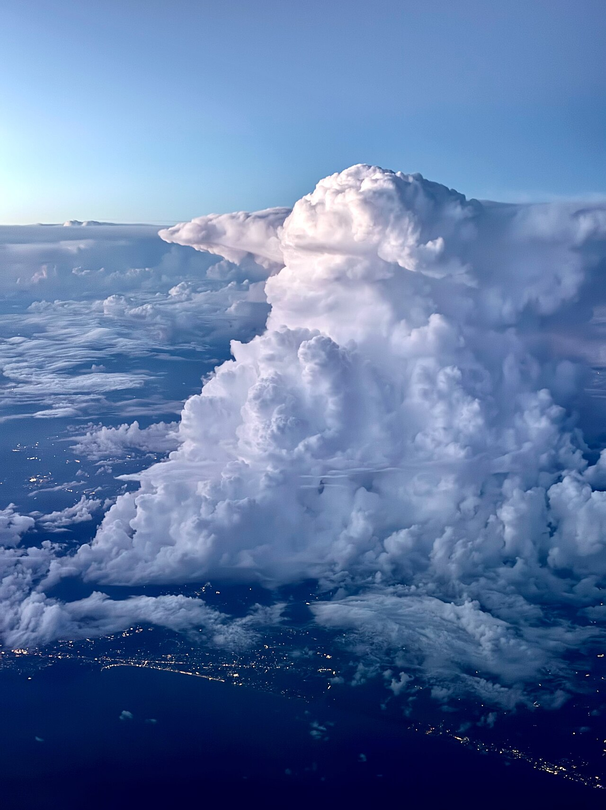

# Купчасто-дощові хмари (Cumulonimbus)

## Як розпізнати

Шукайте високу хмарну вежу з темною основою. Простежте її контур угору. Верхівка буває гладкою або волокнистою й часто розходиться вбік, утворюючи ковадло. Висока купчаста хмара теж може нагадувати вежу. На її верхівці добре видно чіткі округлі виступи. Під час росту вежі придивіться, чи не стають їхні обриси розмитими. Порівняйте з [купчастими хмарами](cumulus.md).

## Висота й утворення

У помірних широтах основа зазвичай лежить у межах 2 км над поверхнею, а верхівка може сягати верхнього ярусу хмар, приблизно 5–13 км над поверхнею. Цей діапазон описує висоту ярусу, а висота самої верхівки залежить від грози. Вологе повітря піднімається й охолоджується, а водяна пара конденсується в краплі. Вище утворюються кристали льоду, які надають верхівці волокнистого вигляду. Якщо повітря доходить до шару, який обмежує подальший підйом, верхівка може розтікатися вбік.

## Чого чекати

Поки вежа росте, придивіться до сірої завіси опадів під нею й до верхівки, що ширшає. Коли висхідний потік слабшає, обриси вежі можуть розмитися, а ковадло ще деякий час залишається в небі після зливи. Якщо завіса опадів наближається, сильна злива може початися за лічені хвилини. Далека гроза може пройти осторонь, і у вас буде сухо.

Дощові краплі під час випаровування охолоджують повітря. Воно може опуститися й розтектися біля поверхні. Прохолодний порив або раптова зміна напрямку вітру можливі ще до дощу, навіть якщо злива омине вас. З форми хмари важко визначити силу поривів і передбачити, наскільки знизиться температура. Ще одна ознака грози — спалах, за яким чути грім. Блискавка так швидко нагріває повітря, що воно різко розширюється й утворює звукову хвилю.

## Фотографії

Ліворуч від центру простежте широке біле ковадло над нижчими хмарами.

Знайдіть золоту верхівку над темною основою. Правий край верхівки переходить у тонкі пасма.

На знімку з літака ведіть погляд уздовж вежі праворуч до пласкішої частини, що тягнеться ліворуч.

[Міжнародний атлас хмар ВМО — Cumulonimbus](https://cloudatlas.wmo.int/en/clouds-genera-cumulonimbus.html) · [Яруси хмар](https://cloudatlas.wmo.int/en/useful-concepts.html) · [Національна метеорологічна служба США — як виникає грім](https://www.weather.gov/safety/lightning-science-thunder)

[Авторство фотографій та умови використання](../../../docs/photo-selection/cumulonimbus/README.md)

[English](../../en/clouds/cumulonimbus.md)
