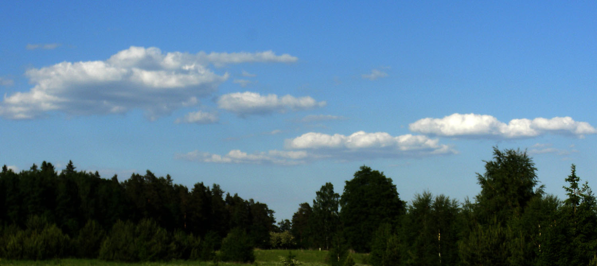
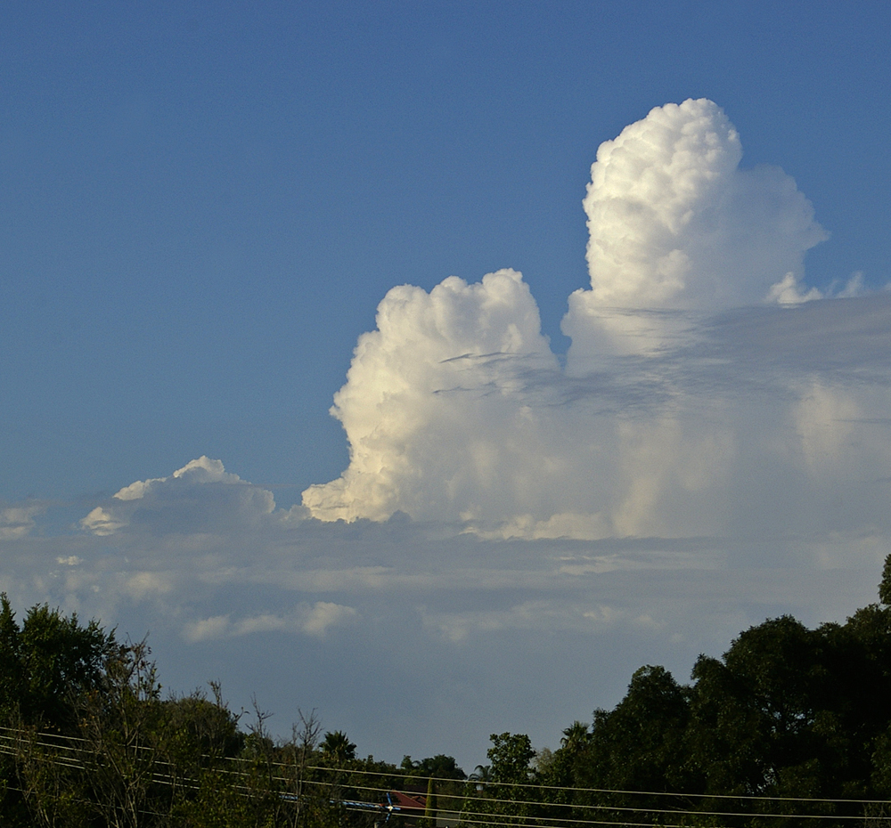

# Купчасті хмари (Cumulus)

## Чому хмара схожа на купу

За полем пливе біла хмара. Збоку видно, що її край з боку землі майже прямий, а з боку синього неба виступають округлі білі горбики. Якщо та сама хмара опиниться просто над вами, вона може виглядати як звичайна сіра пляма.

Сонце нагріває землю, а від неї нагрівається повітря. Воно підіймається й охолоджується. У повітрі є вода у вигляді невидимої пари. На певній висоті стає досить прохолодно, щоб із пари утворилися дрібні краплі. Разом їх уже видно — саме тут починається рівний край хмари. У помірних широтах він часто нижче двох кілометрів. Вище продовжують підійматися окремі порції повітря. Кожна додає до хмари новий білий горбик.

## Чи буде злива

Маленька хмара на кілька хвилин дає тінь. Краплі в ній такі дрібні, що часто встигають випаруватися, і під нею лишається сухо. Погляньте на ту саму хмару трохи згодом. Якщо з одного місця раз у раз виростають нові горбики і хмара вже височіє над сусідніми, крізь хмару досі підіймається повітря. Усередині неї краплі стикаються й зливаються. Ті, що виросли достатньо великими, можуть випасти зливою. А хмара, яка виросла настільки, що вгорі розпускається довгими білими пасмами, схожа на [купчасто-дощову](cumulonimbus.md).

## Фотографії

Верхівка має кілька округлих виступів, а затінений край, повернутий до землі, майже прямий.

Праворуч над лісом рівні сірі краї кількох хмар вишикувалися майже в одну лінію.

На вершечку правої вежі ще добре видно окремі округлі виступи — прикмету купчастої хмари, що росте.

[Міжнародний атлас хмар ВМО](https://cloudatlas.wmo.int/en/clouds-genera-cumulus.html)

[Авторство фотографій та умови використання](../../../docs/photo-selection/cumulus/README.md)

[English](../../en/clouds/cumulus.md)
