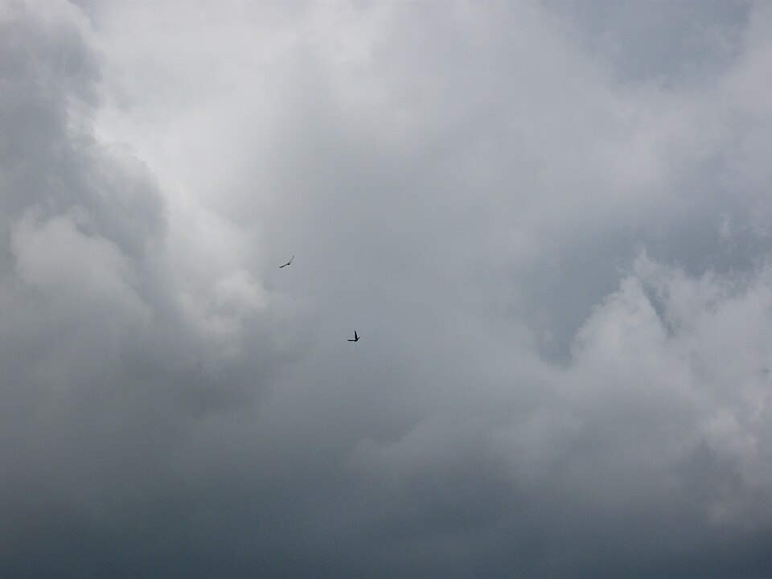
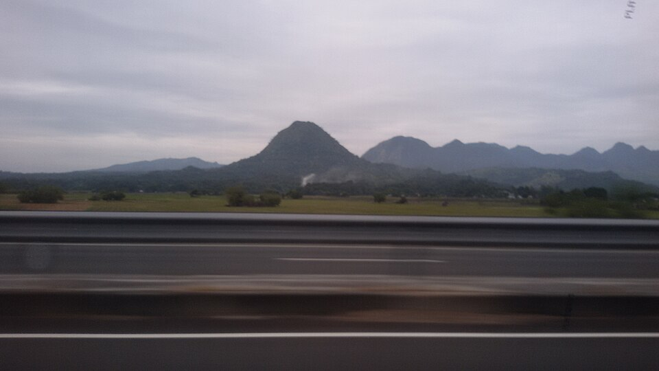
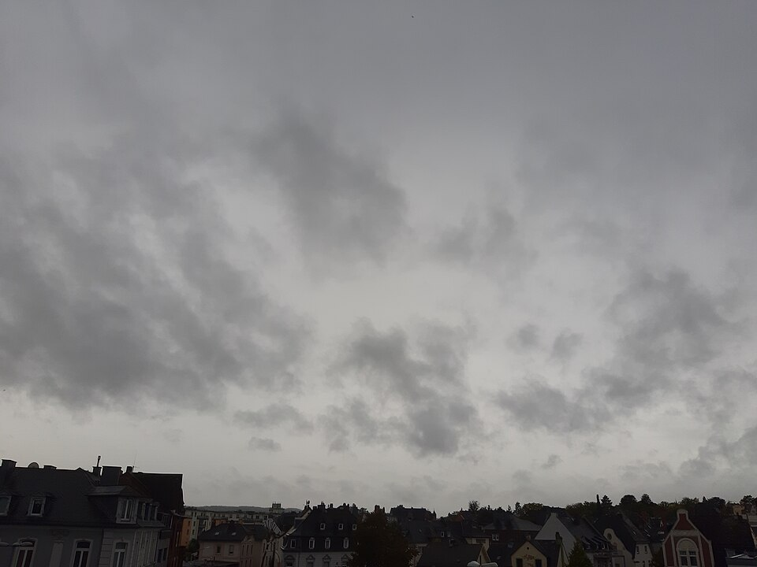

# Шарувато-дощові хмари (Nimbostratus)

## Звідки йде цей дощ

З вікна чи з палуби окрему хмару іноді годі розгледіти. Сонце сховане, дощ затягує вдалині і берег, і небо над ним. Навіть коли на мить дощ слабшає, важко сказати, де саме закінчується хмара. Для впізнавання тут важить те, що видно протягом певного часу. Із самого лише фото сірого неба важко відрізнити цей шар від щільних [високошаруватих хмар](altostratus.md).

## Чому може дощити годинами

Повітря поволі підіймається одразу над великою територією й остигає. Частина водяної пари в ньому перетворюється на краплі та кристали льоду. Поки одні виростають і випадають, інші ще тільки утворюються. У помірних широтах значна частина хмари лежить на висоті 2–7 км. До найближчої видимої частини часто менше двох кілометрів. Решту закривають від вас хмара й опади. Сніжинки дорогою до землі можуть розтанути, тому з тієї самої хмари в різних місцях випадає дощ або сніг.

## Як помітити, що опади слабшають

Низькі темні клапті під дощовим шаром іноді мчать за вітром. Вони виникають у вологому повітрі під основною хмарою і можуть змінитися за лічені хвилини, поки дощ іде так само рівно. Кращий орієнтир — далекий берег чи ліс, який досі ховався за опадами. Якщо його видно дедалі чіткіше і світліша ділянка неба ширшає з того самого боку, до вас може підходити край смуги опадів.

## Фотографії

Відтінки сірого плавно переходять один в один. За таким кадром без спостереження за опадами рід хмари визначити важко.

Контур хребта чіткий, а в небі над ним важко вказати, де саме проходить нижня межа шару.

Клапті над дахами лежать нижче основного шару. Крізь проміжки між ними видно той самий сірий покрив.

[Міжнародний атлас хмар ВМО — Nimbostratus](https://cloudatlas.wmo.int/en/clouds-genera-nimbostratus.html) · [ВМО — відмінність від щільних високошаруватих хмар](https://cloudatlas.wmo.int/en/ns-compared-with-as-op.html)

[Авторство фотографій та умови використання](../../../docs/photo-selection/nimbostratus/README.md)

[English](../../en/clouds/nimbostratus.md)
