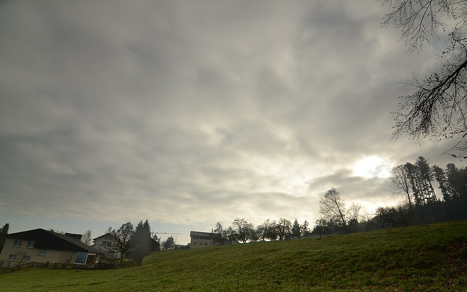

# Шарувато-купчасті хмари (Stratocumulus, Sc)

## На що дивитися

Шукайте широкі вали або округлі хмарні маси в низькому шарі. Простежте край однієї такої маси до місця, де вона зливається із сусідньою або межує з просвітом. Темніші нижні частини й округлі обриси часто помітні навіть тоді, коли хмари вкривають майже все небо. [Шаруваті хмари](stratus.md) виглядають однорідніше. У [висококупчастих хмар](altocumulus.md) окремі елементи зазвичай здаються дрібнішими, якщо дивитися високо над горизонтом.

## Як вони утворюються і змінюються

У помірних широтах увесь шар цих хмар зазвичай лежить у межах перших 2 км над земною поверхнею. Вологе повітря піднімається й охолоджується, і водяна пара конденсується в краплі. Якщо стійкий шар повітря вище гальмує підйом, верхівки низьких [купчастих хмар](cumulus.md) можуть розтікатися вбік і зливатися в пласт.

Поки повітря внизу залишається вологим, шар може триматися годинами. Якщо домішується сухіше повітря, краплі випаровуються і просвіти можуть ширшати. Якщо просвіти закриваються й округлі обриси зникають, порівняйте однорідний покрив із шаруватими хмарами.

## Що це підказує про погоду

Під цими хмарами часто сухо. З товстішого шару можливий слабкий дощ або сніг, а за самим виглядом хмар важко визначити, коли почнуться опади. Простежте рух окремої ділянки хмари відносно верхівки дерева. Біля землі вітер може мати іншу швидкість і напрямок. Під суцільним покривом удень до поверхні доходить менше сонячного світла, а вночі вона може повільніше охолоджуватися.

## Кільце навколо Місяця

Коли Місяць просвічує крізь тонку ділянку хмари, придивіться до невеликого кільця біля нього. Це вінець. Він виникає завдяки дифракції світла, коли світлові хвилі огинають дрібні краплі води.

## Фотографії

Праворуч простежте золотаві краї хмарних валів і блакитні просвіти між ними.

Трохи лівіше від сяйва над деревами роздивіться широкі округлі форми в суцільному сірому шарі.

Над деревами праворуч простежте сірі хмарні маси до середини кадру й знайдіть місця, де між ними видно блакить.

[Міжнародний атлас хмар ВМО — Stratocumulus](https://cloudatlas.wmo.int/en/clouds-genera-stratocumulus.html)

[Авторство фотографій та умови використання](../../../docs/photo-selection/stratocumulus/README.md)

[English](../../en/clouds/stratocumulus.md)
