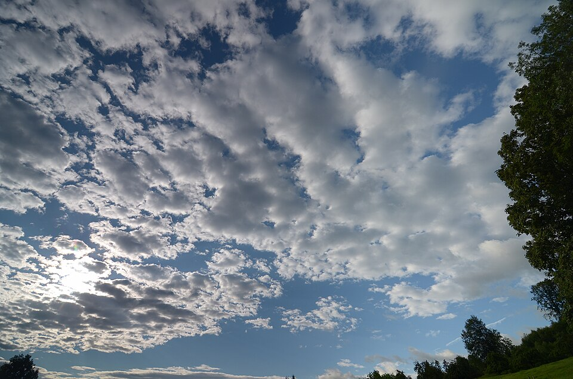

# Шарувато-купчасті хмари (Stratocumulus, Sc)

## Де закінчується одна хмара

Один вал можна простежити до сусіднього, а далі — до вузького віконця блакиті. Коли просвіти закриваються, округлі обриси все ще помітні завдяки світлу й тіні. У схожих за висотою [шаруватих хмар](stratus.md) нижня поверхня значно рівніша.

## Чому шар розростається вшир

У помірних широтах ці хмари зазвичай видно менш ніж за 2 км над землею. Часом зранку над рівниною видно окремі [купчасті хмари](cumulus.md), а по обіді від них лишається майже суцільний покрив. Повітря над нагрітим полем підіймається й остигає. Частина водяної пари в ньому перетворюється на краплі, і з землі стає видно хмари. Якщо вище лежить тепліше повітря, підйом може зупинитися. Тоді хмари розростаються вбік і з’єднуються.

## Що означають просвіти

Під таким покривом часто сухо, хоча з товстіших ділянок можливі слабкі опади. Якщо просвіти ширшають, а краї хмар поступово тануть, сонця протягом найближчої години може побільшати. Один просвіт, який просто проплив над вами, обіцяє лише коротку перерву в тіні.

Суцільний покрив впливає і на температуру над сушею. Вдень він затінює землю й уповільнює прогрівання. Ясної ночі поверхня швидко втрачає тепло, а під низькими хмарами за подібного вітру зазвичай охолоджується повільніше.

## Фотографії

Сонце освітлює краї хмар збоку. Найкраще їхню округлу форму видно праворуч.

Над світлою ділянкою біля обрію вали майже злилися. Окремі виступи ще видно за тінями.

Ближче до середини кадру блакитні проміжки розділяють великі округлі грудки.

[Міжнародний атлас хмар ВМО — Stratocumulus](https://cloudatlas.wmo.int/en/clouds-genera-stratocumulus.html)

[Авторство фотографій та умови використання](../../../docs/photo-selection/stratocumulus/README.md)

[English](../../en/clouds/stratocumulus.md)
