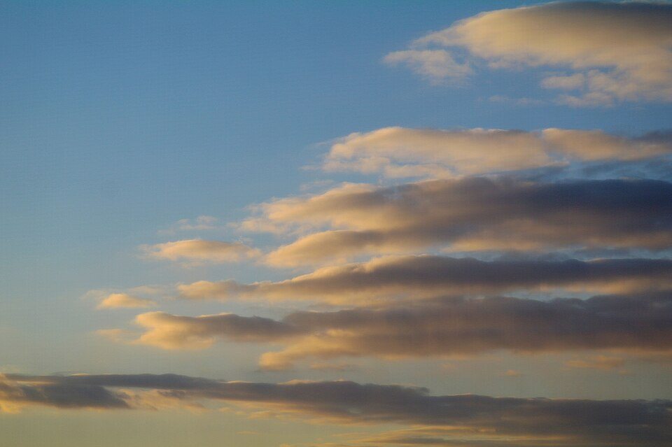

# Шарувато-купчасті (Stratocumulus, Sc)

## Що видно із землі

Над головою тягнуться широкі округлі смуги. Одна частина смуги світла, а поряд лежить тінь. Так можна розрізнити хвилясту форму навіть там, де між хмарами зовсім немає блакиті. У рівного сірого покриву [шаруватих хмар](stratus.md) таких округлих виступів зазвичай не видно.

## Як влаштована хмара

Хмара простягається широким і відносно тонким шаром. Між округлими хмарними масами часом видно просвіти. У помірних широтах такий шар зазвичай лежить на висоті до двох кілометрів над землею. Він складається переважно з крихітних крапель води. Крізь товстіші ділянки проходить менше світла, тому знизу вони здаються темнішими.

## Як вона утворюється

Над рівниною можна простежити, як змінюються окремі [купчасті хмари](cumulus.md). Повітря над теплою землею підіймається й остигає. Там, де з невидимої водяної пари утворюються краплі, виростає біла купа. Іноді вище лежить шар теплішого повітря, який стримує підйом. Верхівки розростаються вбік і можуть зімкнутися в покрив з округлими виступами.

## Що вона означає для погоди

Під цими хмарами часто сухо, з товстіших ділянок іноді накрапає. За самим виглядом цього низького покриву важко сказати, чи згодом піде тривалий дощ. За годину чи дві погляньте, чи побільшало просвітів по всьому небу. Один просвіт, що пропливає над вами, може дати кілька хвилин сонця. Якщо просвітів стає більше, сонце довше грітиме землю.

Уночі хмари повертають до поверхні частину тепла, яке віддає земля. Якщо вітер майже не змінюється і хмари тримаються, земля зазвичай охолоджується повільніше, ніж ясної ночі.

## Звідки назва

У 1840 році німецький метеоролог Людвіг Фрідріх Кемц додав *Stratocumulus* до тодішньої класифікації хмар. Назва поєднує латинські слова *stratus* — «шар» і *cumulus* — «купа». Придивіться, як округлі купи лежать одна біля одної в широкому шарі.

## Народна прикмета

В Ірландії школярі записали прикмету про ранкове сонце: якщо від нього простягаються довгі промені, а невдовзі воно ховається за хмарами, чекай дощу. Такі промені часом видно крізь просвіти в шарувато-купчастих хмарах. Сонце освітлює вузькі смуги повітря, а сусідні ділянки лишаються в тіні. За самими променями важко судити про дощ. Погляньте пізніше, чи просвіти зімкнулися і чи видно за ними смуги опадів над обрієм.

## Фотографії

Сонце освітлює краї хмар збоку. Найкраще їхню округлу форму видно праворуч.

Над світлою ділянкою біля обрію вали майже злилися. Окремі виступи ще видно за тінями.

Ближче до середини кадру блакитні проміжки розділяють великі округлі грудки.

[Міжнародний атлас хмар ВМО — Stratocumulus](https://cloudatlas.wmo.int/en/clouds-genera-stratocumulus.html)

[Міжнародний атлас хмар ВМО — історія назв хмар](https://cloudatlas.wmo.int/en/preface-to-the-1939-edition.html)

[Національна метеорологічна служба США — походження латинських назв хмар](https://www.weather.gov/fgz/cloudscontrails)

[Ірландська фольклорна колекція · Ранкові сонячні промені](https://www.duchas.ie/en/cbes/4921828/4909737/5182583)

[ВМО · Сонячні промені в просвітах](https://cloudatlas.wmo.int/crepuscular-rays.html)

[Авторство фотографій та умови використання](../../../docs/photo-selection/stratocumulus/README.md)

[English](../../en/clouds/stratocumulus.md)
