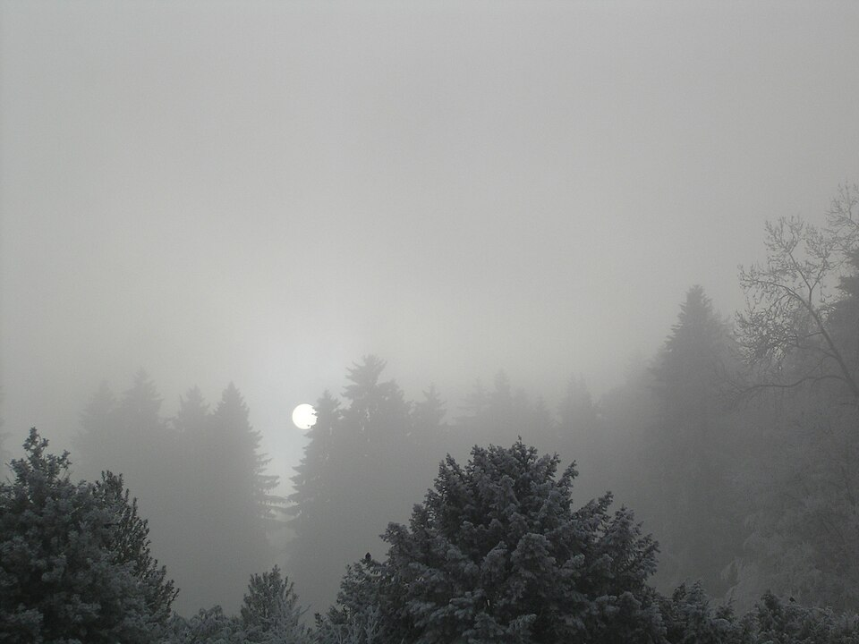
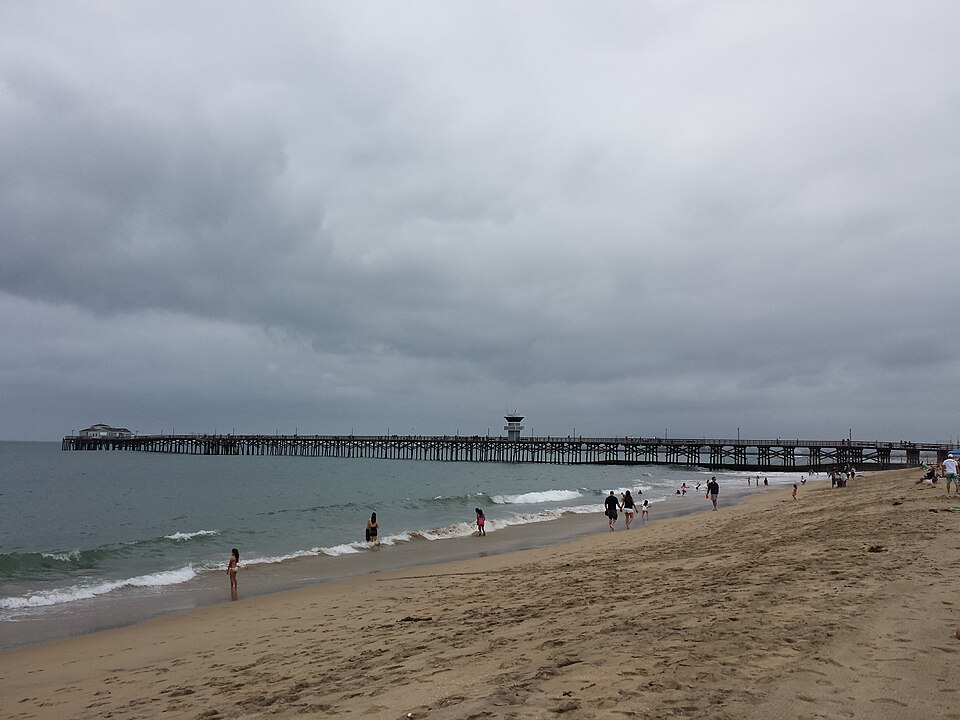

# Шаруваті хмари (Stratus, St)

## Туман, під яким можна пройти

Зранку дерева через поле ледь видно. Потім їхні стовбури знову проступають, а крони ще губляться в сірому. Так можна побачити, де починається низька хмара. Коли вона висить вище дерев, знизу ви бачите просто рівне сіре небо.

У повітрі є невидима водяна пара. Коли повітря охолоджується біля холодної землі чи води, частина пари перетворюється на крихітні краплі. Якщо це відбувається над цілим полем або затокою, краплі утворюють широкий тонкий шар. На рівні очей він виглядає як туман. Коли повітря біля землі прогрівається, найнижчі краплі випаровуються, а над головою ще залишається шарувата хмара. У помірних широтах вона може висіти від висоти дерев до приблизно 2 км.

## Звідки береться мряка

Часто під цією хмарою сухо. Якщо деякі краплі зливаються й підростають, з неї сіється мряка — такі дрібні краплі, що їх легше помітити на темному рукаві, ніж у повітрі. Рясний дощ, який годинами затуляє далекий берег, більше схожий на дощ із [шарувато-дощових хмар](nimbostratus.md).

Над сушею до обіду в хмарі можуть з’явитися вікна блакиті. Сонце прогріває землю, повітря над нею теплішає, і ще більше крапель випаровується. Над холодною водою хмара може зберегтися й після обіду.

## Фотографії

У цьому фрагменті неба видно лише плавну зміну яскравості. Виразних валів або окремих верхівок немає.

Диск Сонця ще має чіткий край. За першим рядом дерев у сіруватій імлі ледь проступають обриси дальніх крон.

Низький шар простягнувся над морем до обрію. Сам пірс під ним ще добре видно.

[Міжнародний атлас хмар ВМО — Stratus](https://cloudatlas.wmo.int/en/clouds-genera-stratus.html)

[Авторство фотографій та умови використання](../../../docs/photo-selection/stratus/README.md)

[English](../../en/clouds/stratus.md)
