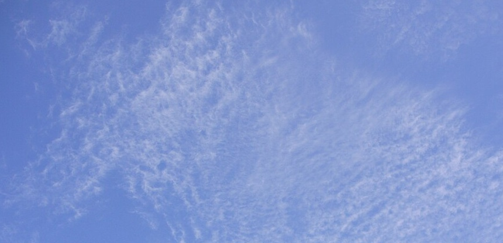
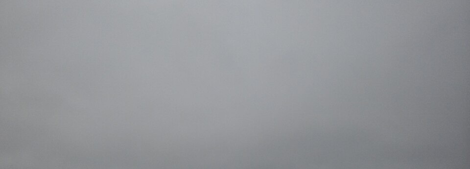

# Cloud photographs

Each entry opens three photographs with field captions, source records and reuse terms. The first photograph is the reference view. The next two show how the same genus can look from another angle, at another distance or under different lighting.

| | |
| --- | --- |
| [**Cirrus**](cirrus/README.md)  | [**Cirrocumulus**](cirrocumulus/README.md)  |
| [**Cirrostratus**](cirrostratus/README.md)  | [**Altocumulus**](altocumulus/README.md)  |
| [**Altostratus**](altostratus/README.md)  | [**Nimbostratus**](nimbostratus/README.md)  |
| [**Stratocumulus**](stratocumulus/README.md)  | [**Stratus**](stratus/README.md)  |
| [**Cumulus**](cumulus/README.md)  | [**Cumulonimbus**](cumulonimbus/README.md)  |
