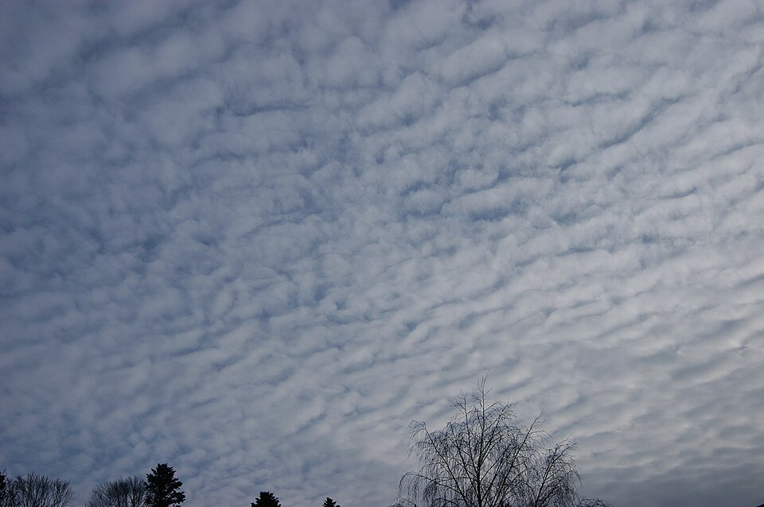
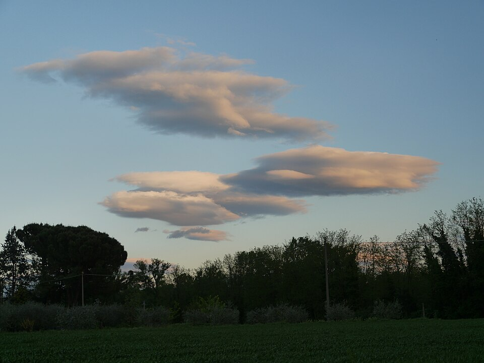

# Altocumulus photographs

The identification check compares the rounded masses, rolls, and shading with the [WMO International Cloud Atlas description of Altocumulus](https://cloudatlas.wmo.int/en/clouds-genera-altocumulus.html).

## 1. Shaded rolls viewed from below

**Caption:** Follow the bright ridges from the lower left toward the center. Each ridge has a darker side, which makes the rolls stand out against the surrounding layer.

**Credit:** “Altocumulus undulatus cloud.jpg” by H. Floreen, NOAA National Weather Service Collection. U.S. public domain as a NOAA employee work. Wikimedia Commons 960-pixel preview, resized from the source without a crop. The source identifies a stratiformis layer with undulatus rolls. [Source and rights declaration](https://commons.wikimedia.org/wiki/File:Altocumulus_undulatus_cloud.jpg)

## 2. Parallel bands above trees

**Caption:** Scan diagonally across the middle of the frame. The rounded elements merge into near-parallel bands, with gray shading along the undersides and narrow blue-gray openings between the bands.

**Credit:** “Altocumulus str un.jpg” by Simon Eugster, CC BY-SA 3.0. Wikimedia Commons 960-pixel preview, resized from the source without a crop. The source identifies Altocumulus stratiformis undulatus. [Source](https://commons.wikimedia.org/wiki/File:Altocumulus_str_un.jpg) · [License](https://creativecommons.org/licenses/by-sa/3.0/)

## 3. Smooth lenses above a field

**Caption:** Trace the smooth upper edge of the large cloud at right to its tapered end. The warm highlights and darker undersides bring out the shape of each lens.

**Credit:** “Isolated Altocumulus lenticularis.jpg” by Dawid Skalec, CC BY-SA 4.0. Wikimedia Commons 960-pixel preview, resized from the source without a crop. The source identifies the lenticularis species. [Source](https://commons.wikimedia.org/wiki/File:Isolated_Altocumulus_lenticularis.jpg) · [License](https://creativecommons.org/licenses/by-sa/4.0/)
