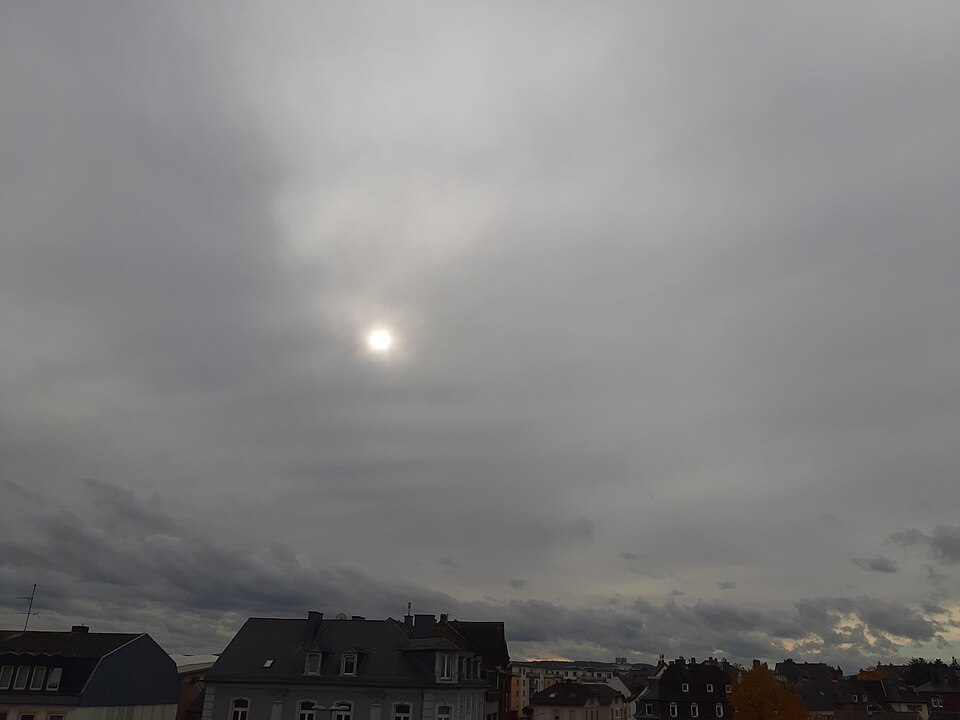
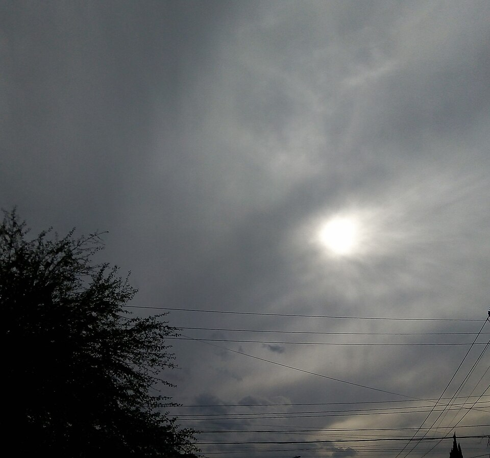

# Altostratus photographs

Compare the continuous grey sheet in each frame and how the Sun shines faintly through its thinner parts. [WMO International Cloud Atlas description of Altostratus](https://cloudatlas.wmo.int/en/clouds-genera-altostratus.html)

## 1. A dimmed Sun through a smooth sheet

**Caption:** Find the small pale Sun above the middle of the frame. The grey sheet continues all around it, and the light fades into the surrounding cloud like light through frosted glass.

**Credit:** “Altostratus translucidus.JPG” by Janne Naukkarinen. Wikimedia’s 960 px-wide JPEG rendition, resized by Wikimedia. The photographer identifies the cloud as Altostratus translucidus and released the photo into the public domain. [Source and rights declaration](https://commons.wikimedia.org/wiki/File:Altostratus_translucidus.JPG)

## 2. Gentle ripples over a town

**Caption:** Look above and to the right of the dim Sun for broad light and dark bands. Follow them across the grey sheet. The rooftops below give you a reference for how far the bands extend.

**Credit:** “Altostratus translucidus undulatus.jpg” by GerritR. Wikimedia’s 960 px-wide JPEG rendition, resized by Wikimedia. The photographer identifies the translucent, wavy layer as Altostratus translucidus undulatus. [Source](https://commons.wikimedia.org/wiki/File:Altostratus_translucidus_undulatus.jpg) · [CC BY-SA 4.0](https://creativecommons.org/licenses/by-sa/4.0/)

## 3. A bright patch in a darker sheet

**Caption:** Start at the glow to the right of centre and move up toward the darker grey. Notice how the light fades within the cloud sheet and how fine bands show up closer to the bottom.

**Credit:** “Altostratus translucidus (18122021).jpg” by Rollcloud. Wikimedia’s 960 px-wide JPEG rendition, resized by Wikimedia. The photographer identifies the cloud as Altostratus translucidus. [Source](https://commons.wikimedia.org/wiki/File:Altostratus_translucidus_%2818122021%29.jpg) · [CC BY-SA 3.0](https://creativecommons.org/licenses/by-sa/3.0/)
