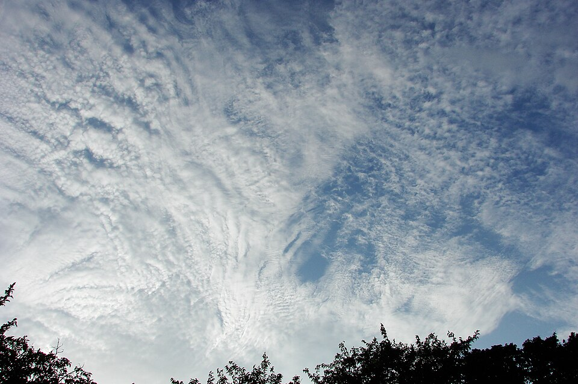
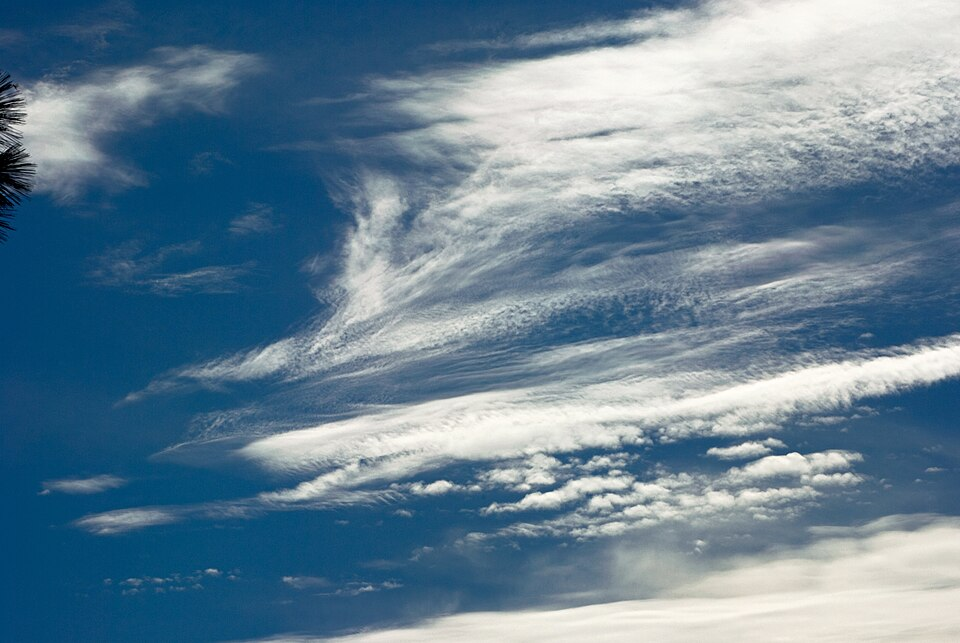

# Cirrocumulus photographs

The identification check compares the thin white grains and ripples with the [WMO International Cloud Atlas description of Cirrocumulus](https://cloudatlas.wmo.int/en/clouds-genera-cirrocumulus.html).

## 1. Fine grains in blue sky

**Caption:** Start with the scattered white grains at upper left, then follow their rows across the middle. At right the rows crowd together, with blue still visible in the narrow spaces.

**Credit:** “Cirrocumulus clouds.JPG” by The High Fin Sperm Whale, CC BY-SA 3.0. Cropped from the Wikimedia Commons 960-pixel preview for a sky-only frame. The source identifies cirrocumulus with some features of the undulatus variety. [Source](https://commons.wikimedia.org/wiki/File:Cirrocumulus_clouds.JPG) · [License](https://creativecommons.org/licenses/by-sa/3.0/)

## 2. A field of curved ripples

**Caption:** Follow the rows rising from the treetops at lower center. They curve outward and break into finer white flecks around the large opening of blue sky.

**Credit:** “Cirrocumulus stratiformis undulatus.jpg” by Loadmaster (David R. Tribble), CC BY-SA 3.0. Wikimedia Commons 960-pixel preview, resized from the source without a crop. The source identifies cirrocumulus in waves, with a perforated pattern on the right. [Source](https://commons.wikimedia.org/wiki/File:Cirrocumulus_stratiformis_undulatus.jpg) · [License](https://creativecommons.org/licenses/by-sa/3.0/)

## 3. Small gaps within slanted bands

**Caption:** Look just above the bright diagonal streak that crosses the lower half. The thin, textured band in the center has small rounded gaps where blue shows through.

**Credit:** “Cirrocumulus lacunosus.jpg” by Suzanne Clute, CC BY-SA 2.0. Wikimedia Commons 960-pixel preview, resized from the source without a crop. The source identifies the lacunosus variety. [Source](https://commons.wikimedia.org/wiki/File:Cirrocumulus_lacunosus.jpg) · [License](https://creativecommons.org/licenses/by-sa/2.0/)
