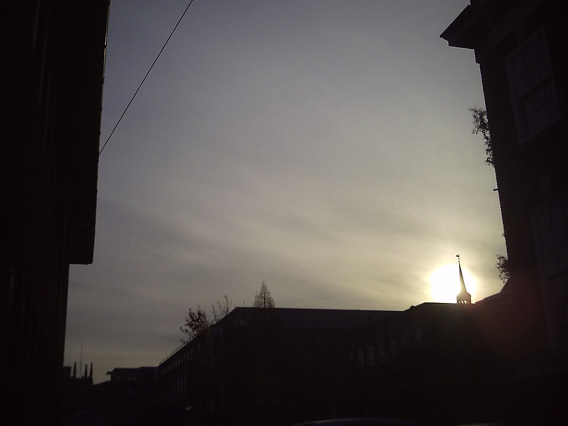
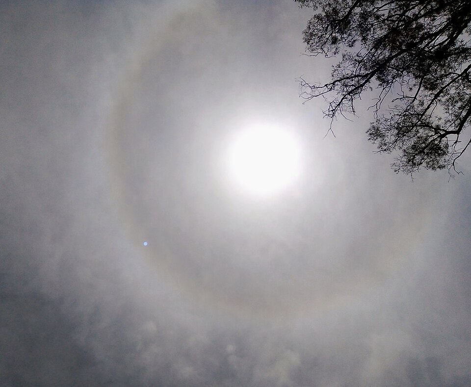

# Cirrostratus photographs

The identification check compares the extent and texture of the thin veil and its halo with the [WMO International Cloud Atlas description of Cirrostratus](https://cloudatlas.wmo.int/en/clouds-genera-cirrostratus.html).

## 1. A thin veil across the frame

**Caption:** Look from the Sun toward the corners of the frame. The blue shows through a continuous, pale veil, and a faint ring is visible around the Sun.

**Credit:** “Clouds CH7.jpg” by Simon Eugster (LivingShadow), licensed under CC BY-SA 2.5. The source identifies Cirrostratus. This JPEG is the Wikimedia Commons preview resized to 960 pixels wide. [Source](https://commons.wikimedia.org/wiki/File:Clouds_CH7.jpg) · [License](https://creativecommons.org/licenses/by-sa/2.5/)

## 2. A fibrous veil above rooftops

**Caption:** Look between the dark rooftops. Faint, slanted fibers run through the broader veil, with the low Sun visible through it at the right.

**Credit:** “Cirrostratus fibratus.jpg” by The Great Cloudwatcher, licensed under CC BY-SA 3.0. The source identifies a sheet of Cirrostratus fibratus. This JPEG is the Wikimedia Commons preview resized to 960 pixels wide. [Source](https://commons.wikimedia.org/wiki/File:Cirrostratus_fibratus.jpg) · [License](https://creativecommons.org/licenses/by-sa/3.0/)

## 3. A solar halo in a smooth veil

**Caption:** Trace the broad ring around the Sun, especially the lower arc away from the branches. The cloud veil outside the ring has little visible texture.

**Credit:** “Sun halo cirrostratus.jpg” by Rollcloud, licensed under CC BY 3.0. The source identifies the smooth veil as Cirrostratus nebulosus. This JPEG is the Wikimedia Commons preview resized to 960 pixels wide. [Source](https://commons.wikimedia.org/wiki/File:Sun_halo_cirrostratus.jpg) · [License](https://creativecommons.org/licenses/by/3.0/)
