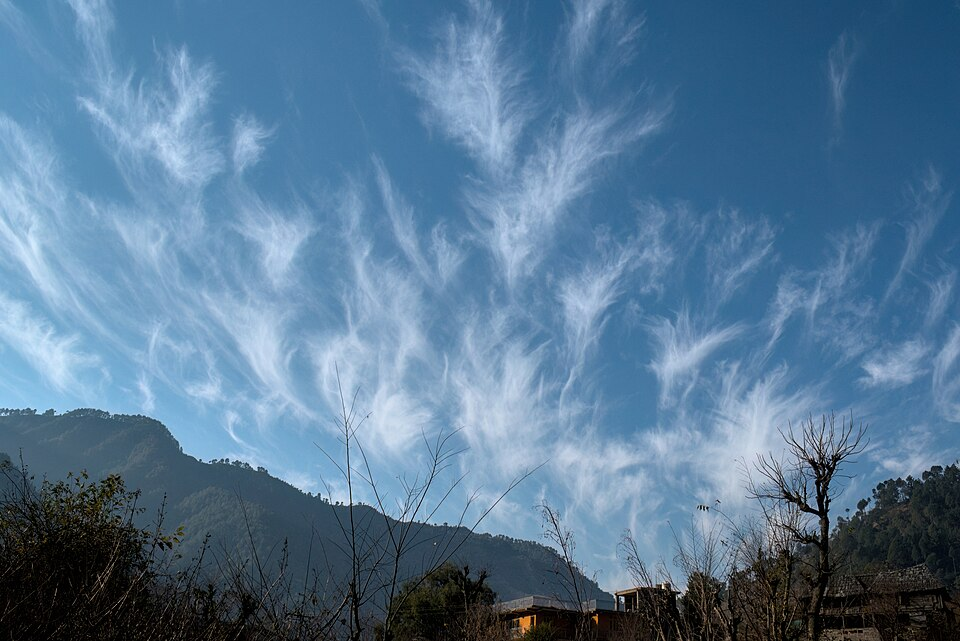
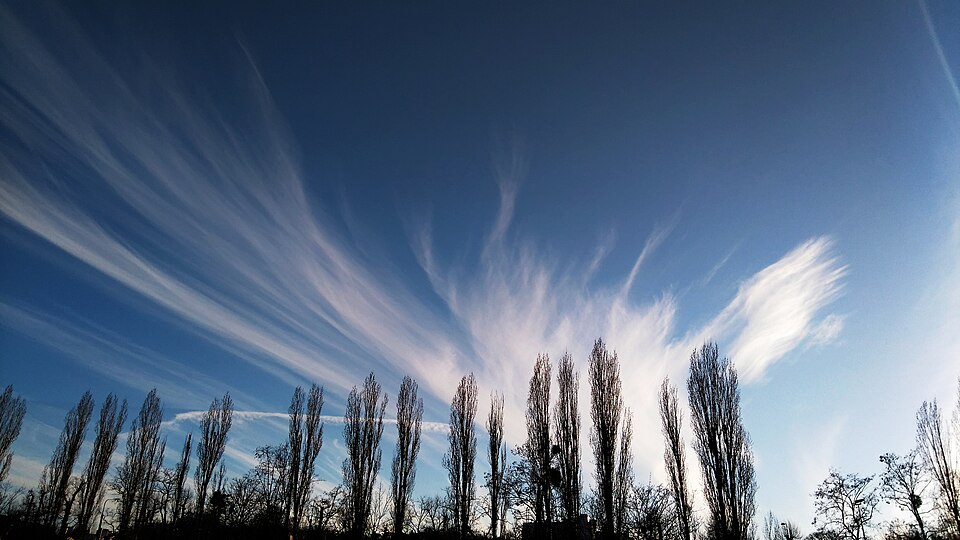

# Cirrus photographs

The identification check compares the separate, hairlike filaments and patches with the [WMO International Cloud Atlas description of Cirrus](https://cloudatlas.wmo.int/en/clouds-genera-cirrus.html).

## 1. Feathery streaks against blue sky

**Caption:** Start with the long, curved streaks in the upper half of the frame. Follow their thin edges into the blue gaps between streaks and then look for the shorter wisps below.

**Credit:** “Cirrus clouds on a sunny day.jpg” by Shocksingularity, dedicated to the public domain under CC0 1.0. The source identifies Cirrus. This JPEG is the Wikimedia Commons preview resized to 960 pixels wide. [Source](https://commons.wikimedia.org/wiki/File:Cirrus_clouds_on_a_sunny_day.jpg) · [Rights declaration](https://creativecommons.org/publicdomain/zero/1.0/)

## 2. Hooked filaments above a ridge

**Caption:** Look above the ridge for filaments with curled tips and thin, trailing strands. Use the blue gaps to pick out one hook at a time.

**Credit:** “Cirrus uncinus clouds in the morning sky.jpg” by ADARSHluck, licensed under CC BY-SA 4.0. The source identifies Cirrus uncinus. This JPEG is the Wikimedia Commons preview resized to 960 pixels wide. [Source](https://commons.wikimedia.org/wiki/File:Cirrus_uncinus_clouds_in_the_morning_sky.jpg) · [License](https://creativecommons.org/licenses/by-sa/4.0/)

## 3. Long filaments above a row of trees

**Caption:** Follow the diagonal bundle at the left down toward the trees. The wider white streak resolves into several slender, nearly parallel threads.

**Credit:** “Cirrus-fibratus.jpg” by A szu, licensed under CC BY-SA 4.0. The source identifies Cirrus fibratus. This JPEG is the Wikimedia Commons preview resized to 960 pixels wide. [Source](https://commons.wikimedia.org/wiki/File:Cirrus-fibratus.jpg) · [License](https://creativecommons.org/licenses/by-sa/4.0/)
