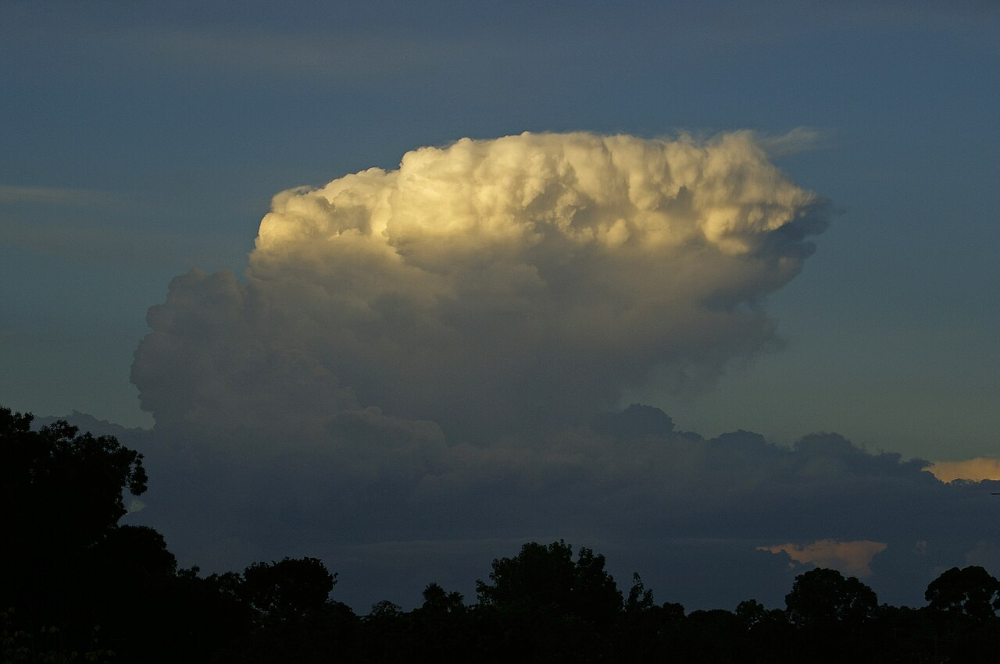

# Cumulonimbus photographs

These three photographs show separate storms. To identify Cumulonimbus, look for the cloud's great vertical extent and a top that smooths out, develops a fibrous edge or spreads into an anvil. [WMO International Cloud Atlas description of Cumulonimbus](https://cloudatlas.wmo.int/en/clouds-genera-cumulonimbus.html)

## 1. An anvil against blue sky

Look above the lower clouds at center left. The tall cloud widens into a broad, nearly flat anvil with fine streaks along its edge.

“20200607 Chmura cumulonimbus incus nad Krakowem 1407 0252.jpg” by Jakub Hałun | CC BY-SA 4.0. The photographer identifies the cloud as Cumulonimbus with an anvil (incus). This version uses the 1,280-pixel-wide Commons resize and is cropped along the bottom to remove the skyline. [Source](https://commons.wikimedia.org/wiki/File:20200607_Chmura_cumulonimbus_incus_nad_Krakowem_1407_0252.jpg) · [License](https://creativecommons.org/licenses/by-sa/4.0/)

## 2. A cloud top lit by the setting sun

Follow the cloud upward from its shadowed base. Evening light picks out the high, spreading crown, especially where its edge feathers out to the right.

“Cumulonimbus capillatus 1.jpg” by Bidgee | CC BY-SA 3.0. The source identifies the cloud as Cumulonimbus capillatus. This version uses the 1,280-pixel-wide Commons resize. [Source](https://commons.wikimedia.org/wiki/File:Cumulonimbus_capillatus_1.jpg) · [License](https://creativecommons.org/licenses/by-sa/3.0/)

## 3. A tall storm cloud from the air

Trace the tall cloud upward from the lower right, then follow the flatter part near the top as it projects to the left. From the air, you can see how far the main tower rises above the surrounding cloud layers.

“Cumulonimbus cloud over Italy.jpg” by kallerna | CC BY-SA 4.0. The source identifies the cloud as Cumulonimbus. This version uses the 1,280-pixel-wide Commons resize. [Source](https://commons.wikimedia.org/wiki/File:Cumulonimbus_cloud_over_Italy.jpg) · [License](https://creativecommons.org/licenses/by-sa/4.0/)
