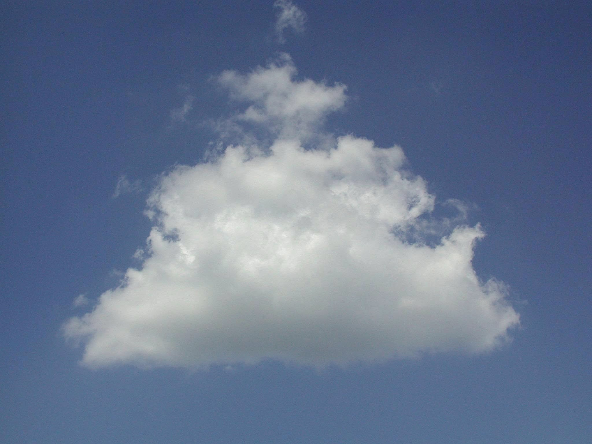
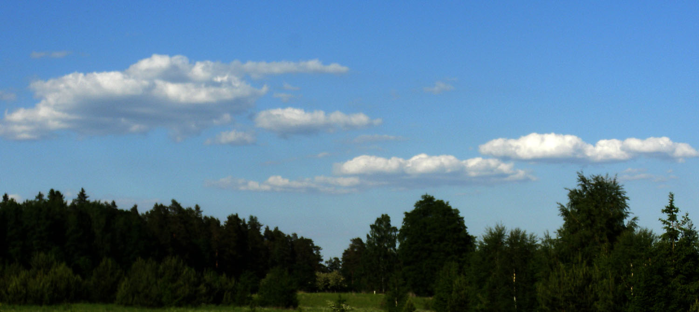
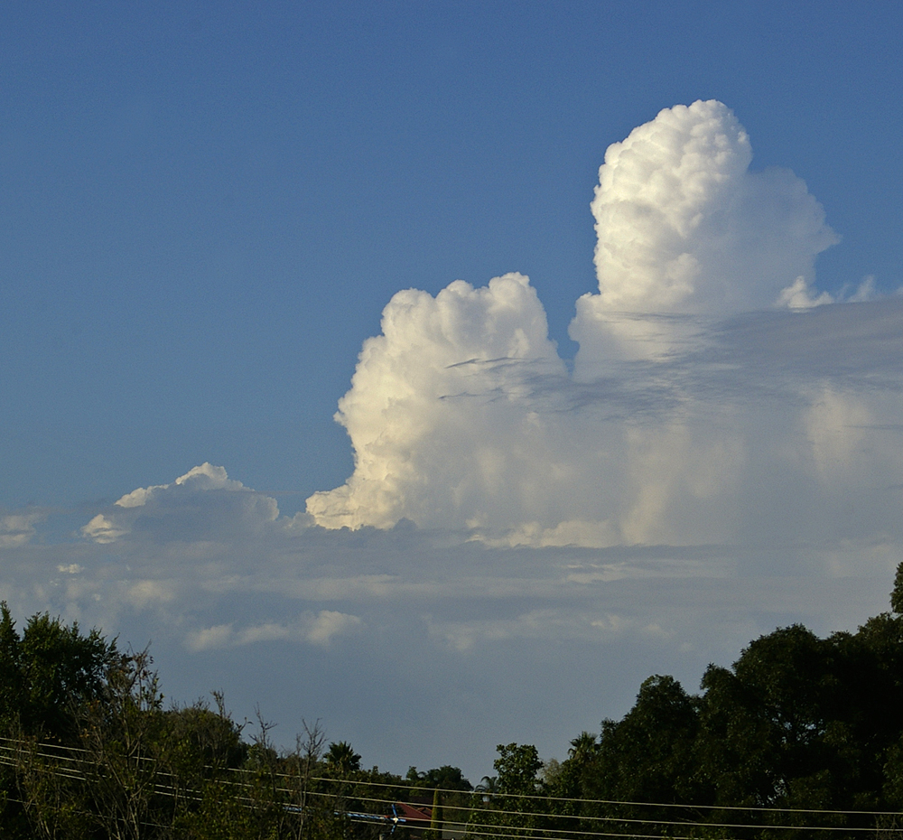

# Cumulus photo shortlist

Three independent observations for editorial review. Their order is for browsing and does not represent a time sequence. The identification check compares the visible outlines, rounded tops and bases with the [WMO International Cloud Atlas description of Cumulus](https://cloudatlas.wmo.int/en/clouds-genera-cumulus.html).

## 1. An isolated cloud against blue sky

**Caption:** Trace the uneven, rounded top, then follow the darker, nearly level lower edge. The blue sky around the cloud makes its outline easy to follow.

**Credit:** “Single cloud on sky” by Paolo Neo. Original JPEG, released into the public domain by the photographer. The Cumulus identification is based on the detached outline, rounded lobes and shaded base visible in the frame, using the WMO description above. [Source and rights declaration](https://commons.wikimedia.org/wiki/File:Single_cloud_on_sky.jpg#Licensing)

## 2. Shallow clouds above a treeline

**Caption:** Follow the row above the trees on the right. Each cloud rises only a little above its nearly level base. Look for the narrow gaps of blue between them.

**Credit:** “Cumulus humilis sweden 2009.jpg” by Kr-val. Original JPEG, released into the public domain by the photographer. The source identifies the shallow form as Cumulus humilis. [Source and rights declaration](https://commons.wikimedia.org/wiki/File:Cumulus_humilis_sweden_2009.jpg)

## 3. A taller tower in side light

**Caption:** Look at the tall tower on the right. Its sunlit edge breaks into rounded lobes, a shape you can also see on the shorter tower to its left.

**Credit:** “Cumulus congestus cloud.jpg” by Bidgee. Original JPEG, distributed under CC BY-SA 3.0. The source identifies towering cumulus. The visible feature to compare here is the crown. [Source](https://commons.wikimedia.org/wiki/File:Cumulus_congestus_cloud.jpg) · [License](https://creativecommons.org/licenses/by-sa/3.0/)
