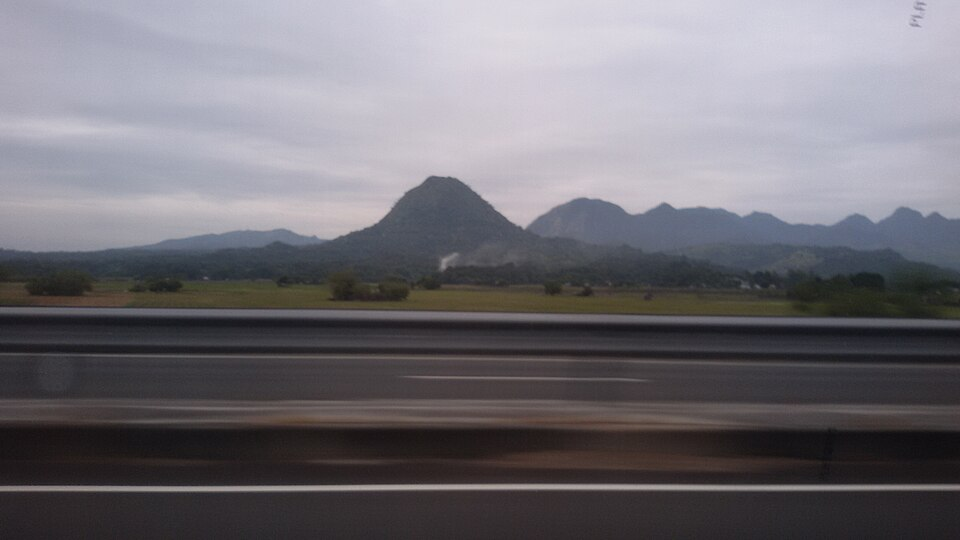
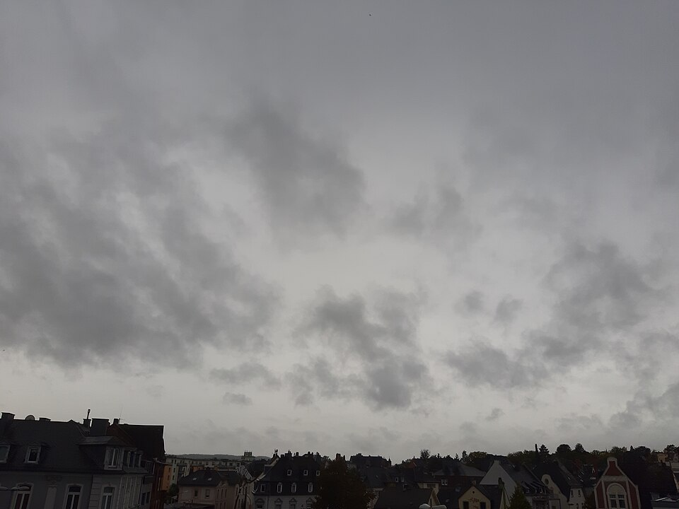

# Nimbostratus photographs

Look for an extensive grey layer with a diffuse underside. Sustained rain or snow reaching the ground can distinguish Nimbostratus from thick Altostratus. These still frames illustrate the appearance of the layer and its surroundings. [WMO International Cloud Atlas description of Nimbostratus](https://cloudatlas.wmo.int/en/clouds-genera-nimbostratus.html) · [WMO comparison with thick Altostratus](https://cloudatlas.wmo.int/en/ns-compared-with-as-op.html)

## 1. A grey layer overhead

**Caption:** Start at the paler area near the top and follow the gradual change to blue-grey at the bottom. The cloud fills the view and its darker portions have soft edges.

**Credit:** “Nimbostratus 01.jpg” by Indrajit Das. Wikimedia’s 960 px-wide JPEG rendition, resized by Wikimedia. The photographer identifies the cloud as Nimbostratus. [Source](https://commons.wikimedia.org/wiki/File:Nimbostratus_01.jpg) · [CC BY-SA 3.0](https://creativecommons.org/licenses/by-sa/3.0/)

## 2. A broad layer over distant hills

**Caption:** Follow the grey sky across the line of hills. Broad, muted bands span the scene while the ridgeline gives you a clear edge to compare with the softer cloud.

**Credit:** “Nimbostratus clouds.jpg” by YuRi YuZi. Wikimedia’s 960 px-wide JPEG rendition, resized by Wikimedia. The photographer identifies the cloud as Nimbostratus near the Subic–Clark–Tarlac Expressway. [Source](https://commons.wikimedia.org/wiki/File:Nimbostratus_clouds.jpg) · [CC BY-SA 4.0](https://creativecommons.org/licenses/by-sa/4.0/)

## 3. Ragged pieces below the layer

**Caption:** Just above the rooftops, pick out the uneven, darker patches. They sit beneath the continuous grey layer that fills the upper part of the frame.

**Credit:** “Nimbostratus pannus.jpg” by GerritR. Wikimedia’s 960 px-wide JPEG rendition, resized by Wikimedia. The photographer identifies the ragged patches as pannus beneath Nimbostratus. [Source](https://commons.wikimedia.org/wiki/File:Nimbostratus_pannus.jpg) · [CC BY-SA 4.0](https://creativecommons.org/licenses/by-sa/4.0/)
