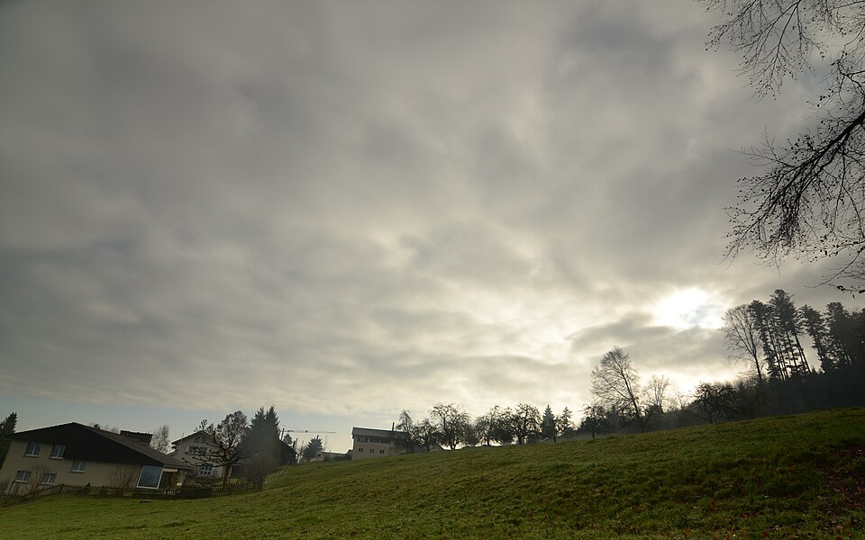
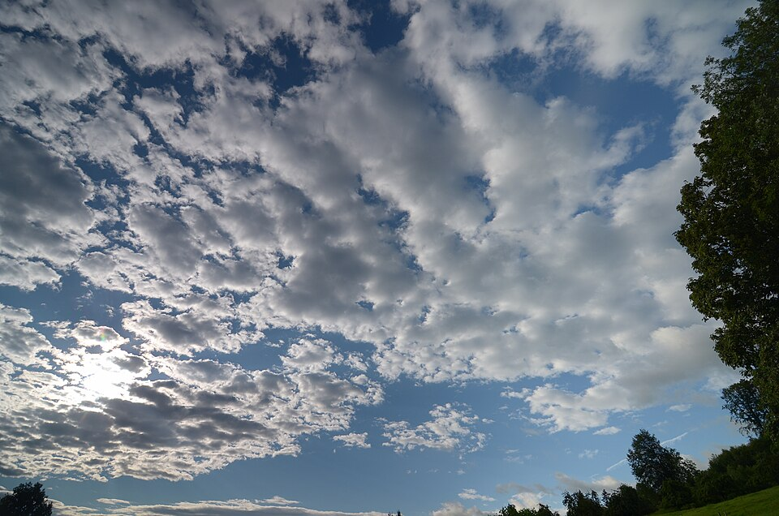

# Stratocumulus photographs

Their order is for browsing and does not represent a time sequence. The identification check compares the broad cloud bands and rounded masses, their shading, and how they join into layers with the [WMO International Cloud Atlas description of Stratocumulus](https://cloudatlas.wmo.int/en/clouds-genera-stratocumulus.html).

## 1. Sunlit rolls with gaps of blue

**Caption** — Look at the broad bands across the right half of the sky. Each has a gold-lit edge and a darker underside, with blue sky between several of the bands.

**Credit** — “SAM_6349” by Alec Perkins, CC BY 2.0. Wikimedia Commons identifies the photograph as Stratocumulus with rolls and gaps. The local JPEG is the 960-pixel-wide Commons rendition with no further edits. [Original Flickr photo](https://www.flickr.com/photos/alecperkins/5322113091/) · [Wikimedia Commons source and license review](https://commons.wikimedia.org/wiki/File:Stratocumulus_stratiformis_undulatus_perlucidus.jpg) · [License](https://creativecommons.org/licenses/by/2.0/)

## 2. A nearly continuous layer at sunrise

**Caption** — Start just left of the bright patch above the trees. You can still make out broad, rounded patches and shallow bands across the grey layer where the clouds have joined.

**Credit** — “Stratocumulus stratiformis translucidus at sunrise.jpg” by Simon A. Eugster, CC BY-SA 3.0. The photographer identifies a layer of Stratocumulus thin enough to reveal the position of the sun. The local JPEG is the 960-pixel-wide Commons rendition with no further edits. [Source](https://commons.wikimedia.org/wiki/File:Stratocumulus_stratiformis_translucidus_at_sunrise.jpg) · [License](https://creativecommons.org/licenses/by-sa/3.0/)

## 3. A broken layer seen from below

**Caption** — Look up past the trees on the right. Follow the rounded grey masses across the middle and notice where their edges join and where blue sky still shows through.

**Credit** — “Stratocumulus stratiformis perlucidus translucidus.jpg” by Simon A. Eugster, CC BY-SA 3.0. The photographer identifies the flattened, connected masses as Stratocumulus and notes the use of a graduated neutral-density filter during capture. The local JPEG is the 960-pixel-wide Commons rendition with no further edits. [Source](https://commons.wikimedia.org/wiki/File:Stratocumulus_stratiformis_perlucidus_translucidus.jpg) · [License](https://creativecommons.org/licenses/by-sa/3.0/)
