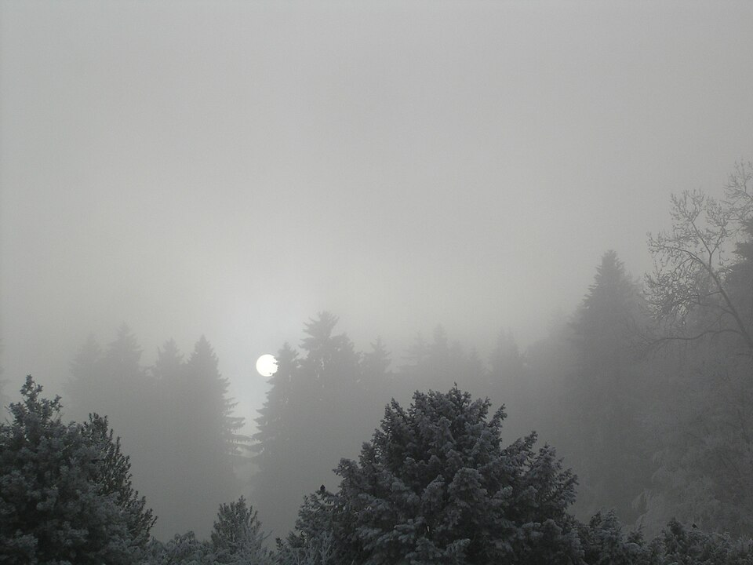
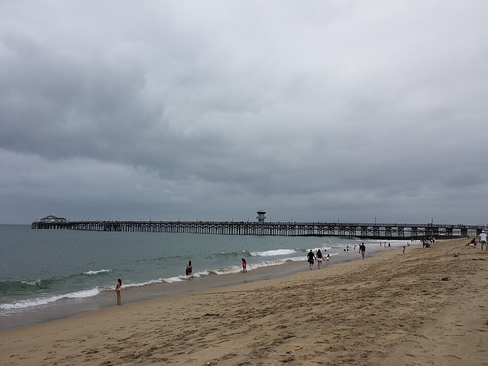

# Stratus photographs

The [WMO International Cloud Atlas description of Stratus](https://cloudatlas.wmo.int/en/clouds-genera-stratus.html) identifies a generally gray layer with a fairly uniform base. When the Sun is visible through the layer, its outline is clearly discernible.

## 1. A nearly uniform gray layer

**Caption:** Look for the slight change from lighter gray near the top to darker gray lower down. The layer fills the frame with very little texture.

**Credit:** “Estratos Nebulosus Opacus.jpg” by Lucas garbarino. Cropped from the 960-pixel Wikimedia rendition to remove buildings and treetops. The cropped image is distributed under CC BY-SA 4.0. [Source](https://commons.wikimedia.org/wiki/File:Estratos_Nebulosus_Opacus.jpg) · [License](https://creativecommons.org/licenses/by-sa/4.0/)

## 2. Sun visible above the treetops

**Caption:** Find the bright circle just above the trees. The Sun’s outline is still visible through the gray layer. The more distant trees fade into the cloud.

**Credit:** “Clouds CL6.jpg” by Simon Eugster. The source identifies the cloud as Stratus nebulosus. This selection uses the uncropped 960-pixel Wikimedia rendition under CC BY-SA 2.5. [Source](https://commons.wikimedia.org/wiki/File:Clouds_CL6.jpg) · [License](https://creativecommons.org/licenses/by-sa/2.5/)

## 3. A low cloud deck over the coast

**Caption:** Follow the gray deck across the sky above the pier. The darker band near the horizon and the lighter area overhead are part of the same broad cover.

**Credit:** “June Gloom at Seal Beach, California, June 2013.jpg” by Darkest tree. The source describes the scene as June Gloom and lists the photo under Stratus clouds. This selection uses the uncropped 960-pixel Wikimedia rendition under CC BY-SA 3.0. [Source](https://commons.wikimedia.org/wiki/File:June_Gloom_at_Seal_Beach,_California,_June_2013.jpg) · [License](https://creativecommons.org/licenses/by-sa/3.0/)
